<div align="center">

# S. G. BALEKUNDRI INSTITUTE OF TECHNOLOGY, BELAGAVI

*(Affiliated to Visvesvaraya Technological University, Belagavi)*

**DEPARTMENT OF [COMPUTER SCIENCE AND ENGINEERING]**

---

# FlutterForge

## An AI-Powered Prompt-to-Flutter Application Generation and Self-Healing Development Platform

---

**A Project Report submitted in partial fulfilment of the requirements for the award of the degree of**

**BACHELOR OF ENGINEERING**

**in**

**[BRANCH / PROGRAMME]**

**Submitted by**

**[Student Name] — [USN]**

**Under the guidance of**

**[Guide Name], [Designation]**

---

**ACADEMIC YEAR 2026 – 2027**

</div>

---

<div align="center">

# S. G. BALEKUNDRI INSTITUTE OF TECHNOLOGY, BELAGAVI

*(Affiliated to Visvesvaraya Technological University, Belagavi)*

**DEPARTMENT OF [COMPUTER SCIENCE AND ENGINEERING]**

---

## CERTIFICATE

</div>

This is to certify that the project work entitled **“FlutterForge — An AI-Powered Prompt-to-Flutter Application Generation and Self-Healing Development Platform”** is a bonafide record of the project work carried out by **[Student Name] (USN: [USN])** under my supervision, in partial fulfilment of the requirements for the award of the degree of **Bachelor of Engineering in [Branch]** of **Visvesvaraya Technological University, Belagavi**, during the academic year **2026–2027**.

The project work has been examined and is found to be satisfactory.

<br/>

| | |
|---|---|
| **Project Guide** | **Head of the Department** |
| [Guide Name] | [HOD Name] |
| [Designation] | [Designation] |
| Signature: ________________ | Signature: ________________ |

<br/>

| | |
|---|---|
| **Internal Examiner** | **External Examiner** |
| Signature: ________________ | Signature: ________________ |

<br/>

<div align="center">

**Principal**

[Principal Name]

Signature: ________________

</div>

---

## DECLARATION

I hereby declare that the project report entitled **“FlutterForge — An AI-Powered Prompt-to-Flutter Application Generation and Self-Healing Development Platform”** is a record of the original work carried out by me under the guidance of **[Guide Name]**, [Designation], Department of [Department], S. G. Balekundri Institute of Technology, Belagavi.

I further declare that this report has not been submitted, in whole or in part, for the award of any other degree or diploma of this or any other university. All third-party libraries, services, and prior research used in this work are acknowledged in the references.

**Place:** Belagavi  
**Date:** [Date]

**Signature:** ________________

**[Student Name] — [USN]**

---

## ACKNOWLEDGEMENT

I express my sincere gratitude to my project guide, **[Guide Name]**, for continuous guidance, technical review, and encouragement throughout the development of this project. I am thankful to **[HOD Name]**, Head of the Department of [Department], and to the faculty and staff of S. G. Balekundri Institute of Technology for their support and for providing the facilities needed to complete this work.

I also thank the open-source communities behind Flutter, Dart, React, Supabase, PostgreSQL, Razorpay, OpenRouter, and the DeepSeek Harness runtime, whose tools made this project possible. Finally, I thank my family and friends for their patience and support during the project.

**[Student Name]**

---

## ABSTRACT

Most software projects begin the same way. There is an empty folder, a toolchain to install, and a long list of configuration files to write before the first screen appears. Generative AI has shortened that ritual considerably. Tools such as Lovable, Bolt.new and v0 will turn a sentence into a working web page, and the result is often good enough to show someone. What they rarely do is finish the job. The generated code may fail to compile, the preview lives inside a hosted sandbox, and there is usually no straightforward route from the generated files to an Android, macOS or Windows build. The work that remains is the work that matters.

This project asks a narrower question. Can a prompt-to-application tool produce a Flutter project that actually compiles, and can the compiler itself be used as the judge of success? FlutterForge is an attempt to answer that question end to end. A brief is sent through a tiered generation pipeline: a hosted language model first, an in-browser multi-agent pipeline second, and a deterministic template as the final fallback. Whatever comes back is written into a real project directory, checked with `dart analyze`, and served as a live Flutter web build. If analysis fails, the diagnostics are handed to a repair agent, which gets three attempts before the system stops and says so. Around that loop sits the rest of a working studio: a Monaco editor, file explorer, allow-listed terminal, version checkpoints, ZIP export, publish targets, and a Supabase schema with row-level security and an INR billing path through Razorpay.

The implementation uses React 18, TypeScript and Vite on the client, a Node bridge for everything privileged, Supabase for identity and persistence, and an Electron shell for the desktop build. The submission snapshot contains 214 frontend source files (about 48,900 lines of TypeScript, TSX and CSS) and roughly 6,600 lines of server TypeScript. At the time of writing, 110 automated tests pass (64 frontend, 46 server), the TypeScript check is clean, and the production build succeeds. The report describes the architecture, data model, generation and repair algorithms, security controls, measured results and the gaps that remain.

---

## KEYWORDS

Generative AI; Large Language Models; Prompt-to-App; Flutter; Dart; Multi-Agent Systems; Self-Healing Software; Automated Program Repair; Supabase; PostgreSQL; Row-Level Security; Razorpay; Electron; Cross-Platform Development.

---

## TABLE OF CONTENTS

| Chapter | Title |
|---|---|
| | **Preliminary Pages** — Certificate · Declaration · Acknowledgement · Abstract · Keywords · Table of Contents · List of Figures · List of Tables · List of Abbreviations |
| **1** | **INTRODUCTION** |
| | 1.1 Background |
| | 1.2 Problem Statement |
| | 1.3 Motivation |
| | 1.4 Objectives |
| | 1.5 Scope of the Project |
| | 1.6 Project Contributions |
| | 1.7 Organization of the Report |
| **2** | **LITERATURE SURVEY / RELATED WORK** |
| | 2.1 Introduction |
| | 2.2 Existing Systems / Approaches |
| | 2.3 Review of Research Papers / Products |
| | 2.4 Comparative Analysis |
| | 2.5 Research / Technical Gap |
| | 2.6 Summary |
| **3** | **REQUIREMENTS AND SYSTEM ANALYSIS** |
| | 3.1 Proposed System |
| | 3.2 Functional Requirements |
| | 3.3 Non-Functional Requirements |
| | 3.4 Hardware Requirements |
| | 3.5 Software Requirements |
| | 3.6 Feasibility Analysis |
| | 3.7 User Roles / Actors |
| **4** | **SYSTEM DESIGN** |
| | 4.1 System Architecture |
| | 4.2 Module Design |
| | 4.3 Use Case Diagram |
| | 4.4 Data Flow / Process Flow |
| | 4.5 Class / Component Design |
| | 4.6 Database Design |
| | 4.7 UI / UX Design |
| | 4.8 Algorithm / Model Design |
| **5** | **IMPLEMENTATION** |
| | 5.1 Development Environment |
| | 5.2 Module-wise Implementation |
| | 5.3 Important Algorithms / Logic |
| | 5.4 Database / API Implementation |
| | 5.5 Security Implementation |
| | 5.6 Screens / User Interface |
| **6** | **TESTING AND VALIDATION** |
| | 6.1 Testing Strategy |
| | 6.2 Test Cases |
| | 6.3 Test Results |
| | 6.4 Performance Evaluation |
| | 6.5 Validation Against Objectives |
| **7** | **RESULTS AND DISCUSSION** |
| | 7.1 Results |
| | 7.2 Comparison with Existing / Baseline Approach |
| | 7.3 Discussion |
| | 7.4 User / Expert Feedback |
| **8** | **CONCLUSION AND FUTURE SCOPE** |
| | 8.1 Conclusion |
| | 8.2 Limitations |
| | 8.3 Future Scope |
| | **REFERENCES** |
| | **APPENDICES** |
| | Appendix A — User Manual / Installation Guide |
| | Appendix B — Source Code / Repository Details |
| | Appendix C — Project Management / Team Contribution |
| | Appendix D — Plagiarism Check Details |
| | Appendix E — Journal Publication |
| | Appendix F — List of Events Attended |

*Page numbers appear in the PDF export (`PROJECT_REPORT.pdf`); this Markdown source lists sections without page numbers.*

---

## LIST OF FIGURES

<!-- LOF:START -->
| Number | Title |
|---|---|
| Figure 1.1 | FlutterForge marketing landing page with the prompt entry point |
| Figure 2.1 | Positioning of FlutterForge relative to existing platforms |
| Figure 3.1 | Proposed system context diagram |
| Figure 4.1 | High-level system architecture |
| Figure 4.2 | Module decomposition and dependency direction |
| Figure 4.3 | Use case diagram |
| Figure 4.4 | Data flow diagram, level 0 (context) |
| Figure 4.5 | Data flow diagram, level 1 |
| Figure 4.6 | Generation process flow with tiered fallback |
| Figure 4.7 | Preview and self-healing sequence |
| Figure 4.8 | Class diagram of the core client and server components |
| Figure 4.9 | Entity–relationship diagram |
| Figure 4.10 | Application route map |
| Figure 4.11 | Dark-mode design language across the landing page and workspace preview |
| Figure 5.1 | Dashboard workbench with project statistics, search, sort, and project cards |
| Figure 5.2 | Embedded agents page with a brief composer, workflow guidance, and prompt library |
| Figure 5.3 | Billing section with the current plan, credits, billing period toggle, and Razorpay plan cards |
| Figure 5.4 | Usage page with balance, allowance, cycle progress, lifetime usage, and the credit ledger |
| Figure 5.5 | Deployments page listing published apps with workspace and live links |
| Figure 5.6 | Integrations page showing backend, model, payment, and toolchain status |
| Figure 5.7 | Profile page with display name, avatar, email, and password reset |
| Figure 5.8 | Settings page with theme, editor, preview, billing, and account controls |
| Figure 5.9 | Keyboard shortcut reference inside the dashboard |
| Figure 5.10 | Projects workbench at a 390 × 844 mobile viewport |
| Figure 5.11 | Billing section at a 390 × 844 mobile viewport |
| Figure 5.12 | Wide layout: the shell is edge-to-edge while content is capped at 1440 px |
| Figure 6.1 | Layered testing strategy |
| Figure 7.1 | Distribution of the 110 automated tests |
<!-- LOF:END -->

---

## LIST OF TABLES

<!-- LOT:START -->
| Number | Title |
|---|---|
| Table 1.1 | Project objectives and success criteria |
| Table 1.2 | Project scope |
| Table 2.1 | Review of research literature |
| Table 2.2 | Review of existing products |
| Table 2.3 | Comparative analysis of prompt-to-app platforms |
| Table 2.4 | Gap-to-requirement mapping |
| Table 3.1 | Functional requirements |
| Table 3.2 | Non-functional requirements |
| Table 3.3 | Hardware requirements |
| Table 3.4 | Software requirements |
| Table 3.5 | Feasibility summary |
| Table 3.6 | Actors and responsibilities |
| Table 4.1 | Component responsibilities |
| Table 4.2 | Module catalogue |
| Table 4.3 | Use case descriptions |
| Table 4.4 | Key classes and responsibilities |
| Table 4.5 | Database table catalogue (19 public tables) |
| Table 4.6 | Index and partition strategy |
| Table 4.7 | Dashboard routes and content |
| Table 4.8 | Agent-to-model-tier routing |
| Table 5.1 | Development environment |
| Table 5.2 | Technology stack |
| Table 5.3 | Pipeline stages and outputs |
| Table 5.4 | Node bridge HTTP API |
| Table 5.5 | Server-sent event contract |
| Table 5.6 | Security threats and controls |
| Table 6.1 | Test levels, tools, and scope |
| Table 6.2 | Functional test cases |
| Table 6.3 | Security test cases |
| Table 6.4 | Frontend test suites |
| Table 6.5 | Server test suites |
| Table 6.6 | Static analysis and build results |
| Table 6.7 | Browser-level verification |
| Table 6.8 | Measured performance on the development machine |
| Table 6.9 | Objective validation matrix |
| Table 7.1 | Functional outcomes |
| Table 7.2 | Comparison with the baseline and existing tools |
| Table 7.3 | Feedback instrument |
| Table 7.4 | Feedback summary (to be completed after the final demonstration) |
<!-- LOT:END -->

---

## LIST OF ABBREVIATIONS

| Abbreviation | Expansion |
|---|---|
| AI | Artificial Intelligence |
| API | Application Programming Interface |
| APR | Automated Program Repair |
| BYOK | Bring Your Own Key |
| CI/CD | Continuous Integration / Continuous Delivery |
| CORS | Cross-Origin Resource Sharing |
| CRUD | Create, Read, Update, Delete |
| CSS | Cascading Style Sheets |
| DFD | Data Flow Diagram |
| DSH | DeepSeek Harness |
| DTO | Data Transfer Object |
| ER | Entity–Relationship |
| HMAC | Hash-based Message Authentication Code |
| HOD | Head of the Department |
| HTML | HyperText Markup Language |
| HTTP | HyperText Transfer Protocol |
| IDE | Integrated Development Environment |
| INR | Indian Rupee |
| IPC | Inter-Process Communication |
| JSON | JavaScript Object Notation |
| JWT | JSON Web Token |
| LLM | Large Language Model |
| LOC | Lines of Code |
| ORM | Object–Relational Mapping |
| OWASP | Open Worldwide Application Security Project |
| PWA | Progressive Web Application |
| RAG | Retrieval-Augmented Generation |
| RLS | Row-Level Security |
| RPC | Remote Procedure Call |
| SDK | Software Development Kit |
| SQL | Structured Query Language |
| SSE | Server-Sent Events |
| UI | User Interface |
| USN | University Seat Number |
| UX | User Experience |
| VTU | Visvesvaraya Technological University |
| WCAG | Web Content Accessibility Guidelines |
| YAML | YAML Ain't Markup Language |
| ZIP | Zone Information Protocol archive format |

---

# CHAPTER 1 – INTRODUCTION

## 1.1 Background

Software is now the main channel through which organisations deliver services, and demand for new applications keeps rising. The number of trained developers does not rise at the same rate. Low-code and no-code platforms tried to close that gap by replacing typed code with visual models. They worked well in narrow cases, particularly internal forms and dashboards, but the trade is usually flexibility: the user assembles screens from the components the platform provides and stays inside its runtime. Generative AI promised something different. Instead of assembling from blocks, describe the application in ordinary language and let a model write the source.

The prompt-to-app category became visible with Lovable, Bolt.new, v0 and Firebase Studio. Each shows that a language model can produce a plausible interface from a short brief, and each has raised expectations about how quickly a project can start. The problems that remain are consistent across them:

1. **The output is often incomplete.** Language models invent packages that do not exist, omit entry files, truncate long files, and write imports that do not resolve.
2. **The feedback loop is weak.** A user who receives broken code often has no easy way to see the compiler error, ask for a fix, and check the fix without leaving the tool.
3. **The stack is narrow.** Most tools optimise for React or one hosting provider. Cross-platform mobile development, database policy design and desktop packaging are left as separate problems.

Flutter is a good target for the third problem. One Dart codebase can target Android, iOS, web, macOS, Windows and Linux, and the toolchain exposes deterministic commands (`pub get`, `analyze`, `build`) that a backend can run without a graphical environment. Supabase supplies the other half: Postgres, authentication, row-level security and edge functions, all open source and all reachable over HTTP. A generated Flutter project that talks to a generated Supabase schema is a real application, not a mock-up.

There is a distinction worth stating plainly, because it shapes the rest of this report. A demo is a screen that looks right. A project is a directory with a valid `pubspec.yaml`, a `lib/main.dart` that calls `runApp`, imports that resolve, and a build that completes. The first can be produced by a single model call. The second needs a compiler, a file system and a loop.

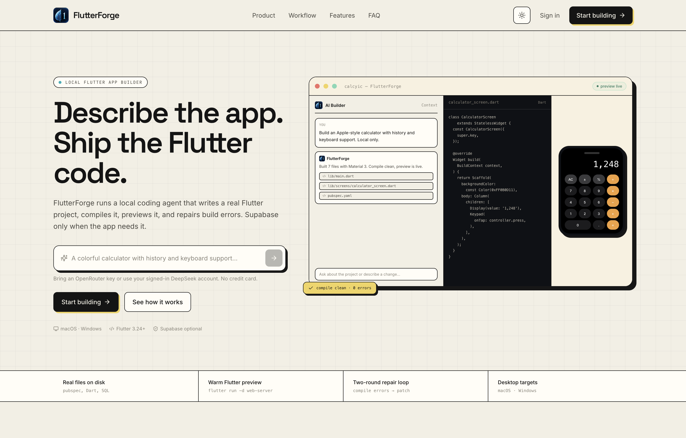

*Figure 1.1 — FlutterForge marketing landing page with the prompt entry point.*

## 1.2 Problem Statement

Given a natural-language description of an application, the system must produce a **complete, runnable, editable Flutter project** that:

- contains a valid `pubspec.yaml` and `lib/main.dart`;
- follows a consistent, feature-first architecture;
- optionally includes Supabase schema, authentication, and row-level security when the brief requires accounts or shared data;
- can be previewed in the browser without the user manually installing an SDK;
- can recover from compiler errors through an automated repair loop;
- can be exported as source or published as a build; and
- is protected by authentication, authorisation, and server-authoritative payment handling.

Two words in that list carry most of the weight. *Complete* means the files needed to build are present and non-empty, which a language model does not reliably guarantee; the pipeline therefore checks for `pubspec.yaml` and `lib/main.dart` before it reports success. *Runnable* means `dart analyze` accepts the code without errors, a stricter test than a model's opinion of its own output. Everything else in the list depends on those two conditions.

The problem, then, is not text generation. It is building a closed loop around generated text: generate, validate, preview, repair, persist and ship. A system that performs only the first step is a demonstration of a compiler, not a development tool.

## 1.3 Motivation

The first observation behind the project is about where beginners lose time. Installing the SDK, creating the project, resolving a version conflict and configuring a platform can take an afternoon before a single feature is written. Little of that work teaches the thing the student set out to learn. A tool that produces a compiling starting point removes a genuine obstacle, not a cosmetic one.

The second observation is about trust in model output. Prompt engineering helps, but no prompt makes a model's output correct by construction. A compiler does not care how confident the model sounded. Placing `dart analyze` between generation and the user turns a probabilistic text problem into a deterministic verification problem, which is a much better place to stand.

The third is ownership. A generated project should be downloadable, runnable with `flutter run`, and editable in any editor the user already has. If the only way to use the output is inside the generator, the user has rented an application rather than built one. This is why export and publish were treated as core features rather than optional extras.

The fourth concerns money. A studio that sells subscriptions has to keep prices, secrets and entitlements on the server. The browser can display a plan; it must not be the authority on whether that plan is active. That constraint shaped the database design more than any other decision in Chapter 4.

## 1.4 Objectives

The project set out to meet eight objectives. They are listed in Table 1.1 together with the criterion used to judge each one. Writing the criterion in advance matters, because it stops the report from claiming success simply because a feature exists. Where an objective is only partly met, Chapter 6 says so directly.

*Table 1.1 — Project objectives and success criteria.*

| ID | Objective | Success criterion | Evidence |
|---|---|---|---|
| O1 | Prompt-to-project generation | A brief yields a project with valid `pubspec.yaml`, `lib/main.dart`, theme, routing, screens, and models | Chapters 4.4, 5.7, 5.8 |
| O2 | Tiered reliability | Generation degrades through defined tiers instead of returning zero files | Chapters 4.4, 6.2 |
| O3 | Self-healing preview | Compile failures trigger targeted repair within a bounded budget | Chapters 4.5, 5.12 |
| O4 | Real persistence and security | Projects, files, conversations, credits, and payments persist under RLS | Chapters 4.6, 5.4 |
| O5 | Full studio workflow | Dashboard, editor, preview, terminal, versions, export, and publishing work together | Chapters 4.7, 5.2 |
| O6 | Desktop delivery | The same workspace runs as a sandboxed Electron application | Chapter 5.17 |
| O7 | Subscription billing | Razorpay orders, HMAC verification, webhook handling, and credit grants are server-authoritative | Chapters 5.15, 6.2 |
| O8 | Verifiable quality | Automated tests, type-check, and a reproducible build pass | Chapter 6 |

## 1.5 Scope of the Project

The boundaries in Table 1.2 were drawn for three reasons: time, external dependencies, and what can be verified without a commercial account. A project of this size can either cover many platforms shallowly or one workflow properly. The second option was chosen.

*Table 1.2 — Project scope.*

| Area | In scope | Out of scope |
|---|---|---|
| Client | React web application and Electron desktop shell | Native Android/iOS client for FlutterForge itself |
| Generation | Prompt-to-Flutter with optional Supabase scaffolding | Fine-tuning a proprietary model |
| Preview | Flutter **web** preview and release build | Native mobile preview inside the browser |
| Persistence | Supabase Auth, Postgres, RLS, Edge Functions | Self-hosted multi-region Postgres cluster |
| Billing | Razorpay Standard Checkout in **test mode**, INR plans | Live merchant settlement and tax invoicing |
| Publishing | Web, PWA, Android, macOS, Windows build targets when toolchains exist | Code signing, notarisation, auto-update |
| Scale | Partitioning, rollups, indexed queries, pooling guidance | A load-tested 10-million-user deployment |

Two rows deserve a note. Preview is limited to Flutter web because a native preview would require an emulator or a device for each platform, and no browser can host one. The web build is a faithful view of the widget tree, so it shows layout, navigation and state changes, but it cannot show platform channels or native plugins. Billing runs against Razorpay test mode. The order, signature and webhook paths are real; what is missing is a merchant account, settlement and tax handling, none of which belongs in an academic submission.

## 1.6 Project Contributions

The work makes seven contributions, listed here in rough order of importance.

1. **An end-to-end prompt-to-Flutter studio.** Generation, persistence, compilation, preview, repair, export and publishing are connected in one interface rather than scattered across separate tools.
2. **A tiered generation architecture.** A hosted edge function, an in-browser multi-agent pipeline and a deterministic fallback are combined behind explicit completeness gates, so failure at one tier does not end the session.
3. **A compile-gated, warm preview service.** Dependencies and build artefacts are cached, `dart analyze` runs before anything is served, and both a warm development server and a static release build are supported.
4. **A bounded self-healing loop.** Real compiler logs are fed back to a repair agent, and the loop stops after three attempts instead of consuming model quota without limit.
5. **A production-oriented Supabase schema.** The migrations cover RLS, security-definer RPCs, monthly usage partitions, daily rollups, atomic credit spending, idempotent payment recording and admin analytics.
6. **A secure desktop bridge.** Electron runs with context isolation, a sandboxed renderer and OS-backed credential storage, so the renderer never gains direct access to the file system or the key vault.
7. **A documented and tested implementation.** There are 110 automated tests, integration tests that drive the real HTTP and SSE surface, and a browser-level check of the dashboard flows. The limits of that testing are described in Chapter 6 rather than hidden.


## 1.7 Organization of the Report

Chapter 2 surveys related work and positions FlutterForge against existing tools. Chapter 3 derives the proposed system, its actors and its requirements. Chapter 4 covers architecture, modules, use cases, data flow, class structure, database design, interface design and algorithms. Chapter 5 describes how each part was built, including the security controls and the screens. Chapter 6 reports the testing strategy, test cases, results, measured timings and objective validation. Chapter 7 discusses what the results mean and compares the approach with a template-only baseline. Chapter 8 states the limitations plainly and lists what would come next. References and appendices contain the user manual, repository details, project management record, plagiarism check, publication status and event list.


> **Note on evidence.** Metrics, test counts, file counts, and feature descriptions were taken from the repository snapshot documented in Appendix B. Screenshots show a seeded demonstration account and are included to document the interface, not to claim production usage. Items that require live external services are identified explicitly in Section 6.5 and Section 8.2.

---

# CHAPTER 2 – LITERATURE SURVEY / RELATED WORK

## 2.1 Introduction

This chapter reviews the background that shaped the design. It starts with the platforms that came before prompt-to-app tools, then looks at the research behind code generation, multi-agent decomposition, retrieval and automated repair. The product comparison follows, and the chapter closes with the gap the project tries to fill.

The survey is deliberately uneven. The literature on code generation and program repair is large and well documented, and it is summarised briefly. The product material, by contrast, comes from documentation, release notes and hands-on use rather than peer review, and it moves quickly. Every claim about a product in this chapter is therefore about what that product does as described in its own documentation, not about measured performance.

## 2.2 Existing Systems / Approaches

### 2.2.1 Visual low-code platforms

OutSystems, Mendix, and FlutterFlow abstract software construction into visual models and reusable components. They improve delivery speed and allow non-programmers to participate, but they constrain the solution space: custom logic, unusual integrations, and performance-critical paths often require escape hatches or vendor-specific extensions. FlutterFlow is the closest to this project because it also targets Flutter; however, its primary interaction is a visual canvas, and AI assistance is secondary.

### 2.2.2 Prompt-to-web platforms

Lovable, Bolt.new, and v0 generate React or Next.js applications from a prompt and provide a hosted preview. They demonstrate the commercial demand for prompt-to-app tools and set a high bar for interface polish. Their output is web-centric: Flutter/Dart, mobile packaging, and desktop packaging are outside their main path.

### 2.2.3 AI-assisted IDEs

Cursor, GitHub Copilot, and similar tools accelerate code writing inside an existing project. They assume a developer and a repository; they do not scaffold a complete application, provision a database, or manage preview and publishing as a single workflow. FlutterForge borrows their inline assistance ideas but applies them to a project that the system itself creates.

### 2.2.4 Flutter-specific tooling

Flutter's CLI provides `flutter create`, `flutter pub get`, `dart analyze`, `flutter run -d web-server`, and platform build commands. These deterministic tools are the backbone of the preview and publishing services. FlutterFlow and Firebase Studio add hosted workflows, but neither exposes a compiler-gated, self-healing loop with an exportable Flutter codebase and an open SQL backend.

### 2.2.5 Large language models for code

The publication that made execution-based evaluation standard for code models is Chen et al., *Evaluating Large Language Models Trained on Code* [1], which introduced HumanEval. The argument was simple and it has not changed: a generated program is useful only if it runs, so it must be executed. Nijkamp et al. extended the idea to multi-turn synthesis in CodeGen [2], where a model refines a program across several exchanges rather than writing it once. Both papers report a failure pattern that this project encountered repeatedly during development. Models invent APIs that do not exist, stop in the middle of a file, and import packages that are not declared in `pubspec.yaml`. HumanEval measures whether a solution passes tests. It does not measure whether the surrounding project builds.

The consequence for FlutterForge is that model output must be treated as a hypothesis. The hypothesis is tested with `dart analyze`, and if it fails, the diagnostics are returned to the model. That is the whole idea behind the compile gate in Chapter 4.

### 2.2.6 Multi-agent decomposition

A single prompt cannot reliably produce a whole application, because the instructions for architecture, data, screens and backend compete for the same context window. The usual response is to split the work across agents, each with a narrow prompt and a narrow output, sharing a state object. This trades one problem for three: latency increases, cost multiplies, and an error in an early stage contaminates every later stage.

FlutterForge follows the pattern but keeps the state explicit. Thirteen stages write into a shared `ProjectState` object, and each stage catches its own failure and preserves the previous state. The design is described in Chapter 4 and the implementation in Chapter 5.

### 2.2.7 Retrieval-augmented generation

Retrieval-augmented generation, or RAG, improves a prompt by adding relevant material that the model has not seen during training. In a code studio, that material is usually documentation, design patterns, or the user's own previous code. The standard method is to embed each item, store the vectors, and search for the nearest neighbours of the current request.

The repository contains the machinery for this. There is a `code_patterns` table with a 768-dimensional `vector(768)` column, a `project_file_embeddings` table, and functions in `full_schema.sql` for similarity search. The generation prompt does not use them yet. This is stated here because the design exists in the schema and not in the runtime, and it belongs in the limitations rather than in the achievements.

### 2.2.8 Automated program repair

Automated program repair has two families: search-based repair, which mutates a program until the tests pass, and generate-and-validate, which asks a model to fix a specific diagnostic. The second family is what FlutterForge uses. The cautionary result is Olausson et al., *Is Self-Repair a Silver Bullet for Code Generation?* [3]. Self-repair fixes many failures, but it can also break code that was working, and the number of repair rounds matters. A repair loop without a budget is a cost and a correctness risk at the same time.

The project responds to that finding in three ways: repairs are limited to three attempts, the original files are retained so the user can roll back, and every repaired version is checkpointed in `project_versions`.

## 2.3 Review of Research Papers / Products

Table 2.1 lists the papers and specifications that directly influenced the design. Two of them shaped the preview loop, one shaped the repair budget, two shaped the database, and two supplied the checklist against which the security chapter was written. The list is short on purpose. A literature survey is not a citation count, and adding references that did not change a decision would misrepresent the work.


*Table 2.1 — Review of research literature.*

| Ref. | Work | Contribution | Relevance to FlutterForge |
|---|---|---|---|
| [1] | Chen et al., “Evaluating Large Language Models Trained on Code” (2021) | Establishes execution-based evaluation of generated code | Motivates the compile gate; pass@k is not enough without execution |
| [2] | Nijkamp et al., “CodeGen” (2023) | Multi-turn program synthesis with natural language | Supports conversational refinement and the edit agent |
| [3] | Olausson et al., “Is Self-Repair a Silver Bullet?” (2024) | Shows self-repair helps but can introduce new errors | Justifies bounded repair and retaining the original files |
| [8] | PostgreSQL table partitioning | Declarative range/list partitioning | Used for the monthly `usage_events` ledger |
| [9] | PostgreSQL row security policies | Policy-based row filtering | Basis of the multi-tenant authorisation model |
| [16] | OWASP ASVS | Verification requirements for secure applications | Used as a checklist for auth, access control, and secrets |
| [24] | ISO/IEC/IEEE 29148:2018 | Requirements engineering lifecycle | Structure of Chapter 3 |
| [30] | NIST SSDF SP 800-218 | Secure software development practices | Secure defaults and review discipline |

*Table 2.2 — Review of existing products.*

| Product | Primary output | What it establishes | What it lacks for this problem |
|---|---|---|---|
| **Lovable** | React/Next.js web apps | Polished prompt-to-app UX, hosted preview, GitHub sync | No Flutter/Dart output, no desktop packaging |
| **Bolt.new** | Web apps in a browser sandbox | Fast in-browser runtime, npm ecosystem | Web-centric, limited native/mobile output |
| **v0** | React/Next.js UI | High-quality UI generation, component systems | UI-focused, not a full application lifecycle |
| **FlutterFlow** | Flutter apps | Visual Flutter builder, Firebase integration, code export | Visual workflow; AI is assistive, not the primary interface |
| **Firebase Studio** | Full-stack apps | Google-backed workspace, emulators, deployment | Broad and heavy; Flutter is one option among many |

The product review in Table 2.2 is more tentative. These tools ship features on a schedule, so a comparison written today will be wrong within a year. The useful observation is not the feature list but the shape of the product: each one optimises for a particular first user, and none of them optimise for a Flutter project that the user can take away and build on their own machine.


## 2.4 Comparative Analysis

Table 2.3 compares the systems on the criteria that matter here. The list is long, but most rows reduce to a single question: when the model fails, who fixes the code? A tool that only generates has nowhere to send the error. A tool that generates and compiles can hand the diagnostic to a repair step, and a tool that also persists the project can keep the user's edits while doing so.

*Table 2.3 — Comparative analysis of prompt-to-app platforms.*

| Criterion | FlutterForge | Lovable | Bolt.new | v0 | FlutterFlow |
|---|---|---|---|---|---|
| Primary output | Flutter + Supabase | React/Next.js | Web apps | React UI | Flutter |
| Prompt-first | Yes | Yes | Yes | Yes | Partial |
| Live preview | Flutter web | Web | Web | Web | Flutter |
| Compiler feedback in loop | Yes (`dart analyze`) | Build logs | Build logs | Build logs | Visual validation |
| Automatic repair | Yes, bounded | Limited | Limited | Limited | No |
| Export source | Yes (ZIP) | GitHub sync | Yes | Yes | Yes |
| Generates DB policies | Yes (RLS) | Partial | No | No | Firebase rules |
| Built-in subscription billing | Razorpay INR + credits | Stripe | Stripe | Stripe | External |
| Desktop packaging | Electron shell + Flutter targets | No | No | No | Limited |
| Self-hostable | Yes (local bridge) | No | No | No | No |

Figure 2.1 positions the systems on two axes: how cross-platform the output is, and how AI-native the interaction is.

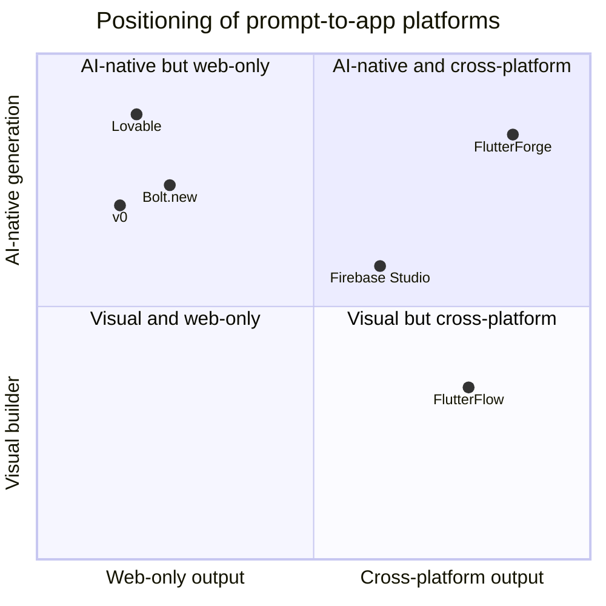

*Figure 2.1 — Positioning of FlutterForge relative to existing platforms.*

## 2.5 Research / Technical Gap

The literature and product review converge on four gaps:

1. **Flutter is under-served.** Prompt-to-app investment concentrates on the JavaScript ecosystem. Flutter's cross-platform reach and deterministic analyzer make it an ideal target for compiler-in-the-loop generation.
2. **Compilation is not part of the contract.** Most products stream code and logs but do not treat analyzer success as a gate before declaring success.
3. **Repair is unbounded or absent.** Systems that do repair often retry without a budget or without preserving the last known-good files.
4. **Backend policy is hand-waved.** Generated apps frequently include a database schema but not row-level security, credit accounting, or server-authoritative payment handling.

The fourth gap is the one this project could not close completely. Row-level security and the credit ledger are implemented, and the payment verification path is real, but the step that turns a verified payment into an active plan is not wired in the client. That gap is described again in Section 8.2.


*Table 2.4 — Gap-to-requirement mapping.*

| Gap | Requirement introduced | Where addressed |
|---|---|---|
| Flutter output | Generate a complete Dart project with a valid package and entry point | FR-04, Chapter 5.7 |
| Compiler in the loop | Run `dart analyze` before serving a preview | FR-09, Chapter 4.5 |
| Bounded repair | Limit automatic repair and preserve user files | FR-10, Chapter 5.12 |
| Backend security | Generate and enforce RLS plus security-definer RPCs | FR-17, Chapter 4.6 |
| Trustworthy billing | Server-side prices, HMAC verification, idempotency | FR-18, Chapter 5.15 |
| Ownership | Export source and publish without a proprietary runtime | FR-14/FR-15, Chapter 5.16 |

## 2.6 Summary

The survey leaves three conclusions. First, generation is no longer the hard part; verification is. Second, the value of a generated project depends on whether the user can own it, which means export and a build that does not require the generator. Third, a tool that holds a database and takes payments must enforce both at the server, because the browser is not a trustworthy place to keep a ledger. Chapter 3 turns those conclusions into requirements and actors.

---

# CHAPTER 3 – REQUIREMENTS AND SYSTEM ANALYSIS

## 3.1 Proposed System

FlutterForge is a browser-based and desktop-based application studio. A signed-in user describes an application in natural language, optionally selects a platform, state-management style, theme, Flutter version, and backend mode, and receives a complete Flutter project. The project is persisted in Supabase, materialised on a local Node bridge, compiled with the Flutter toolchain, and served as a live web preview. If compilation fails, the diagnostics are fed back to a repair agent. The user can edit files in Monaco, run allow-listed terminal commands, create version checkpoints, compare diffs, export a ZIP, and publish to web, PWA, Android, macOS, or Windows when the required toolchain is present.

The proposed system is novel in combining three normally separate concerns:

- **generation** (LLM prompting and multi-agent decomposition),
- **verification** (schema validation, pre-write fixes, `dart analyze`, build logs), and
- **operations** (persistence, credits, billing, publishing, desktop packaging).

The flow is short enough to describe in one sentence. The user types a brief, the studio writes files to Supabase, the bridge compiles them and returns a URL, and the browser shows the result inside an iframe. Everything else, including the editor, terminal and version history, hangs off that loop rather than replacing it.

Figure 3.1 shows the system context. The user interacts with the React studio; the studio uses Supabase for identity and data, an edge function or the browser agent for generation, the Node bridge for compile and publish work, and Razorpay for payments.

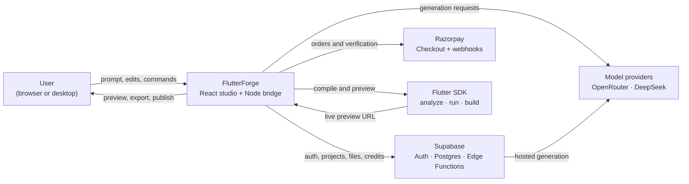

*Figure 3.1 — Proposed system context diagram.*

## 3.2 Functional Requirements

The functional requirements in Table 3.1 are ordered by the journey of a single project rather than by module. A user must be able to authenticate, create a project, generate it, see it run, edit it, save it and take it away. Requirements that describe an internal mechanism, such as dependency hashing or row-level security, are expressed as non-functional requirements instead. Priorities follow the same rule: *Must* means the project is unusable without it, *Should* means the workflow is incomplete, and *Could* means the feature exists in the database or is expected later.

*Table 3.1 — Functional requirements.*

| ID | Requirement | Priority |
|---|---|---|
| FR-01 | Users can sign up, sign in, sign out, and reset a password via Supabase Auth. | Must |
| FR-02 | Authenticated users can create, rename, open, and delete projects. | Must |
| FR-03 | The creation wizard captures a prompt, app name, platform, state management, theme, Flutter version, and backend mode (Auto / Supabase / Local). | Must |
| FR-04 | The system generates a complete Flutter project from the brief, including `pubspec.yaml` and `lib/main.dart`. | Must |
| FR-05 | Users can request incremental edits in natural language without losing existing files. | Must |
| FR-06 | Generation progress is streamed to the UI (phases, files, validation, completion, errors). | Must |
| FR-07 | The workspace provides a file explorer, Monaco code editor, and save/create/delete operations. | Must |
| FR-08 | Users can build and preview the app as Flutter web inside an iframe. | Must |
| FR-09 | Compiler diagnostics are visible and are attached to the preview session. | Must |
| FR-10 | A failed preview build triggers automatic repair, up to a bounded number of attempts. | Should |
| FR-11 | Users can create version checkpoints, view diffs, and restore a version. | Should |
| FR-12 | Dependencies can be inspected and added. | Should |
| FR-13 | A terminal executes an allow-listed set of commands inside the project workspace. | Should |
| FR-14 | Users can export the project as a ZIP archive. | Must |
| FR-15 | Users can publish Web, PWA, Android, macOS, and Windows targets when the toolchain is available. | Should |
| FR-16 | Projects can be shared through a public link (database RPC foundation present; UI partial). | Could |
| FR-17 | Each user has a credit wallet with a monthly allowance and a usage ledger. | Must |
| FR-18 | Users can purchase Pro/Team plans through Razorpay in INR with server-side verification. | Must |
| FR-19 | Users can edit their profile, avatar, password, theme, and preferences. | Should |
| FR-20 | Operators can query aggregate usage and revenue through admin SQL RPCs. | Could |
| FR-21 | The same workspace runs as an Electron desktop application. | Should |
| FR-22 | The dashboard exposes projects, agents, deployments, usage, billing, integrations, profile, settings, and shortcuts as real routes. | Must |
| FR-23 | An agents page offers a brief composer, workflow guidance, and a reusable prompt library. | Should |
| FR-24 | Legal and privacy information is available in-app. | Should |

## 3.3 Non-Functional Requirements

Table 3.2 is the part of the specification that decides whether the system survives contact with real users. A tool that generates a beautiful application and then exposes another user's project is not a tool. Several of these requirements are therefore absolute: secrets stay out of the browser, every user-owned table carries row-level security, and credits are deducted by a locked database transaction rather than by a client request.

*Table 3.2 — Non-functional requirements.*

| ID | Category | Requirement |
|---|---|---|
| NFR-01 | Performance | A warm preview should reload in seconds, not minutes, by reusing `.dart_tool`, `pubspec.lock`, and build output. |
| NFR-02 | Performance | Dashboard queries must use indexed paths and avoid per-row RLS re-evaluation. |
| NFR-03 | Scalability | The schema must support partitioning and rollups for high-volume usage data. |
| NFR-04 | Security | The browser must never receive the Razorpay secret, service-role key, or provider keys. |
| NFR-05 | Security | Every user-owned table must enforce row-level security. |
| NFR-06 | Reliability | Generation must degrade through defined tiers rather than returning zero files. |
| NFR-07 | Reliability | A project may run only one generation at a time; concurrent requests receive a clear conflict. |
| NFR-08 | Maintainability | TypeScript strict mode, modular feature folders, and automated tests. |
| NFR-09 | Portability | The UI must run in a browser, in Docker, and in Electron without code forks. |
| NFR-10 | Usability | The dashboard must be keyboard navigable, responsive, and usable at mobile widths. |
| NFR-11 | Observability | Build logs, generation phases, and errors must be visible to the user and retained per session. |
| NFR-12 | Accessibility | Interactive controls need accessible names, focus states, and reduced-motion support. |
| NFR-13 | Cost | Model routing must prefer fast/economy models for routine work and reserve frontier models for planning and first-pass generation. |
| NFR-14 | Data retention | Raw usage events are prunable; daily rollups preserve aggregates. |

## 3.4 Hardware Requirements

*Table 3.3 — Hardware requirements.*

| Component | Minimum | Recommended |
|---|---|---|
| CPU | 4 cores | 8+ cores (Apple silicon or x86-64) |
| RAM | 8 GB | 16–32 GB |
| Disk | 10 GB free | 25 GB+ free (Flutter SDK, pub cache, build output) |
| Display | 1366 × 768 | 1920 × 1080 or higher |
| Network | Broadband | Broadband; model APIs require outbound HTTPS |
| Desktop builds | Host OS toolchain | macOS 14+ for macOS builds; Windows 11 + Visual Studio for Windows builds |

## 3.5 Software Requirements

*Table 3.4 — Software requirements.*

| Category | Software / version |
|---|---|
| Operating system | macOS 13+, Windows 10+, or Ubuntu 22.04+ |
| Runtime | Node.js 20 LTS or newer; npm 10+ |
| UI stack | React 18.3, TypeScript 5.6, Vite 5.4, Tailwind CSS 3.4 |
| Flutter toolchain | Flutter 3.24+ (development used 3.47.5), Dart 3.4+ (development used 3.13.4) |
| Backend | Supabase project (Auth, Postgres, Edge Functions) |
| Database | PostgreSQL 15+ with `pgvector` and `pg_trgm` |
| Payments | Razorpay test account and webhook secret (optional for local tests) |
| Desktop | Electron 33 and electron-builder 25 |
| Browser | Chrome/Edge/Firefox/Safari current versions with iframe and `localStorage` |
| Container | Docker 24+ (optional) |
| Testing | Vitest 2.1, Testing Library 16, `node:test` |

## 3.6 Feasibility Analysis

### 3.6.1 Technical feasibility

All core technologies are mature and available: Flutter, Node.js, React, Supabase, PostgreSQL with `pgvector`, Razorpay, and Electron. The only heavyweight external dependency is the Flutter SDK, which can be discovered or provisioned. The architecture separates the privileged Node bridge from the browser, avoiding the need to run a compiler inside the renderer.

### 3.6.2 Economic feasibility

The system can run on a developer laptop with free OpenRouter models, a free Supabase tier, and Razorpay test mode. Paid plans are priced in INR (Pro ₹1,999/month, Team ₹4,999/month) to cover model and infrastructure costs. Economy models handle edits and mechanical stages, reducing token spend.

### 3.6.3 Operational feasibility

The web build is a static bundle served by the Node bridge. Docker provides a reproducible deployment. Desktop installers are produced with `electron-builder`. Partition creation, subscription expiry, and retention can be scheduled with `pg_cron`. The main operational caveat is that the generation engine is not bundled in the Docker image; an operator must mount a DeepSeek Harness runtime or rely on the edge/browser paths.

### 3.6.4 Schedule feasibility

The project was executed in phases: literature review and requirements, architecture and schema design, generation pipeline, preview and repair, dashboard and workspace, billing and security, testing and documentation. The phase plan and contribution record are given in Appendix C.

The riskiest assumption is the one nobody can test in advance. The whole design depends on a compiler being available on the machine that serves the preview. If it is not, the preview falls back to a static release build, which still works but takes longer, and if that fails too the user is told plainly rather than left with a spinner. Everything else, including the model providers and the payment gateway, has a documented fallback inside the system.

*Table 3.5 — Feasibility summary.*

| Dimension | Finding | Risk |
|---|---|---|
| Technical | Feasible with mature open-source components | Flutter SDK size and platform toolchains |
| Economic | Feasible on free tiers and test mode | Model quota exhaustion |
| Operational | Feasible for local and container deployment | Harness runtime must be mounted |
| Schedule | Feasible in an academic year | External API availability during demos |

## 3.7 User Roles / Actors

Table 3.6 separates actors by what they can do, not by who they are. The visitor, the registered user and the subscriber are the same person at different moments, and the permissions follow the account rather than the session. The secondary actors matter as much as the primary ones. A model provider can fail, Razorpay can be unreachable, and the Flutter SDK can be missing; each of those failures has a defined behaviour in the design.

*Table 3.6 — Actors and responsibilities.*

| Actor | Type | Responsibilities / permissions |
|---|---|---|
| **Visitor** | Primary | View marketing pages, legal information, and public shared projects; sign up or sign in |
| **Registered user** | Primary | Create and manage projects, generate and edit code, preview, export, publish, manage own profile |
| **Free-plan user** | Primary | Use the monthly free credit allowance and free-plan features |
| **Pro/Team subscriber** | Primary | Access paid allowances and priority model routing |
| **Platform operator / admin** | Primary | Query aggregate usage and revenue through admin RPCs; manage retention and subscription expiry |
| **AI provider** | Secondary | Serve model completions through the edge function or browser pipeline |
| **Supabase** | Secondary | Authenticate users, store data, enforce RLS, run edge functions |
| **Razorpay** | Secondary | Process payment, return signature, deliver webhooks |
| **Flutter toolchain** | Secondary | Analyze, run, and build generated projects on the bridge host |

---
# CHAPTER 4 – SYSTEM DESIGN

## 4.1 System Architecture

FlutterForge is organised into four planes:

- **Client plane** — the React application, Zustand stores, Monaco editor, dashboard, and preview iframe.
- **Hosted plane** — Supabase for identity, data, edge functions, and Razorpay for payments.
- **Local privileged plane** — the Node bridge that owns workspaces, child processes, Flutter, and secrets.
- **Model plane** — OpenRouter and DeepSeek routes used by the edge function, the browser agent, and the optional harness.

The separation is deliberate. The renderer cannot spawn processes or read arbitrary files; every privileged action crosses an explicit HTTP or IPC boundary. The local plane keeps the compiler close to the source, which removes upload latency and lets the preview reuse build artefacts.

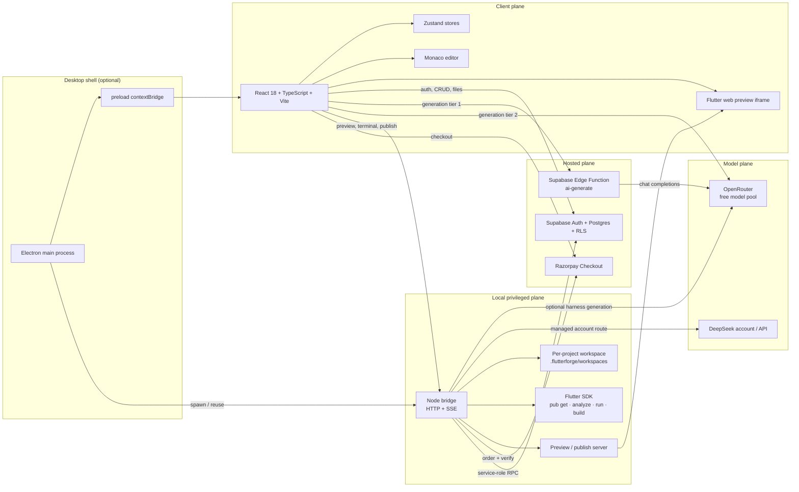

*Figure 4.1 — High-level system architecture.*

Three decisions in this diagram deserve a sentence each. The compiler lives on the local machine because a Flutter web build needs the SDK, a pub cache and several minutes of CPU; uploading a project to a remote build service for every edit would make iteration unbearable. The model calls can be made either in the browser or on the server, and the design supports both, because a hosted edge function removes the need for the user to supply a key, while a browser call is the only option when the function is not deployed. Finally, the database is the authority for identity, files, credits and payments. The browser keeps a copy for display, and every write that matters goes through a security-definer function.


*Table 4.1 — Component responsibilities.*

| Component | Responsibility | Key technology |
|---|---|---|
| `src/pages` | Route-level pages: landing, auth, dashboard, workspace, legal | React Router 7 |
| `src/features/dashboard` | Dashboard shell, sidebar, project cards, wizard, section pages | React, Tailwind |
| `src/features/workspace` | AI builder, editor, preview, files, dependencies, versions, export, terminal | Monaco, iframe |
| `src/stores` | Auth, project, credits, preview, terminal, workspace, theme, credentials, publish, activity | Zustand 5 |
| `src/agents` + `src/agent` | In-browser multi-agent pipeline, model routing, key pool, pre-write validation, repair | TypeScript |
| `src/orchestrator` | Shared `ProjectState` blackboard and pipeline graph | TypeScript |
| `server/index.ts` | HTTP routing, SSE, static UI, preview/publish/terminal, Razorpay, credentials | Node.js |
| `server/harness` | Workspace lifecycle, DSH spawning, event projection, Flutter discovery, prompts, skills | Node.js, child processes |
| `server/preview.ts` | Warm preview, dependency cache, compile gate, static build, reverse proxy | Flutter CLI |
| `server/publish.ts` | Build and host Web/PWA/Android/macOS/Windows artefacts | Flutter CLI |
| `server/razorpay.ts` | Orders, HMAC verification, fulfillment, webhook handling | Razorpay SDK |
| `supabase/functions/ai-generate` | Hosted LLM generation with model fallback chain and code-block parsing | Deno |
| `supabase/migrations` | Schema, RLS, credits, billing, admin operations, vector store | PostgreSQL |
| `electron` | Window, menu, engine lifecycle, credential vault, IPC | Electron 33 |

## 4.2 Module Design

The system is decomposed into eleven modules. Figure 4.2 shows the dependency direction: the UI depends on stores and shared utilities; stores depend on the Supabase client, the agent layer, and the bridge API; the bridge depends on the Flutter toolchain and the harness; the database is the shared persistence contract.

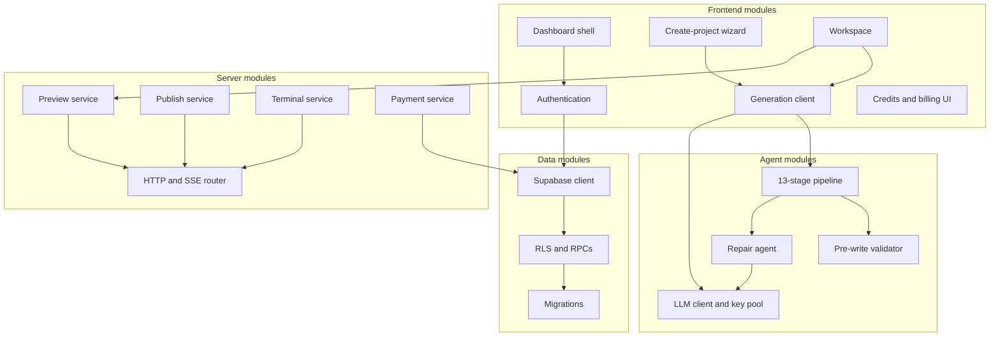

*Figure 4.2 — Module decomposition and dependency direction.*

The arrows point one way. The interface never calls the server, and the server never calls the model client, so a change in one layer does not force a change in the layer below it. The cost of that discipline is some duplication: the client needs its own view of the preview status and the server keeps its own session map. The duplication is deliberate. A shared object would be more elegant and would couple two processes that fail independently.


*Table 4.2 — Module catalogue.*

| Module | Inputs | Outputs | Primary files |
|---|---|---|---|
| Authentication | Email, password, OAuth callback | Session, profile row | `src/stores/auth.store.ts`, `src/features/auth/*` |
| Dashboard | Session, projects, credits | Routed sections, project cards | `src/pages/DashboardPage.tsx`, `src/features/dashboard/*` |
| Wizard | Brief, platform, backend mode | Project row, initial prompt | `CreateProjectWizard.tsx` |
| Generation client | Prompt, context, settings | File changes, progress events | `src/stores/project.store.ts`, `src/agents/*` |
| Workspace | Files, active tab, preview state | Editor, preview, terminal, export | `src/pages/WorkspacePage.tsx`, `src/features/workspace/*` |
| Preview service | Project files | Diagnostics, preview URL, logs | `server/preview.ts` |
| Publish service | Project files, target | Artefact, build report | `server/publish.ts` |
| Payment service | Plan, order, signature, webhook | Verified payment, credits | `server/razorpay.ts` |
| Credits | Usage events, plan | Wallet balance, ledger | `src/stores/credits.store.ts`, SQL RPCs |
| Database | Migrations, queries | Tables, policies, functions | `supabase/*.sql` |
| Desktop shell | Renderer, bridge | Window, menu, vault, IPC | `electron/*.cjs` |

## 4.3 Use Case Diagram

Figure 4.3 shows the primary actors and use cases. The visitor can browse and authenticate; the registered user owns the full project lifecycle; the subscriber gains paid allowances; the operator uses SQL-level administration. Supabase, Razorpay, and the model providers are supporting actors.

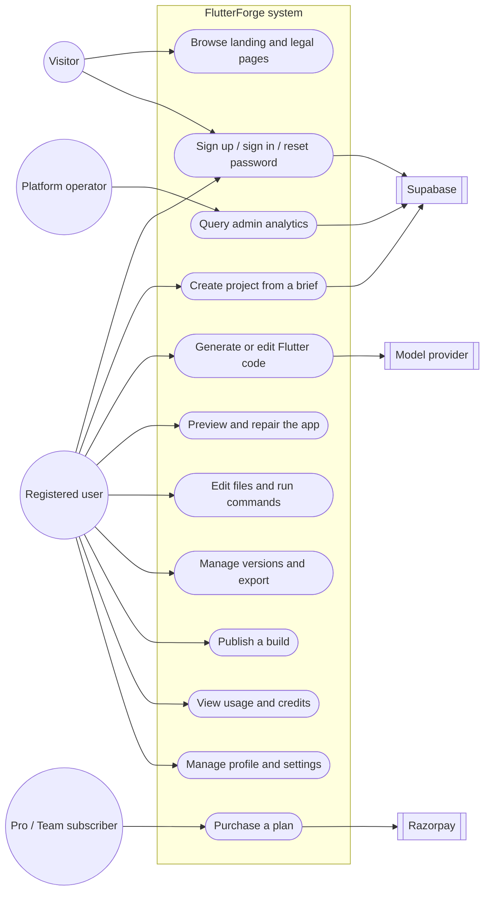

*Figure 4.3 — Use case diagram.*

*Table 4.3 — Use case descriptions.*

| ID | Use case | Actor | Precondition | Postcondition |
|---|---|---|---|---|
| UC-01 | Browse landing and legal pages | Visitor | None | Public content is shown |
| UC-02 | Sign up / sign in / reset password | Visitor, user | Valid email | Session established or reset mail sent |
| UC-03 | Create project from a brief | User | Signed in | Project row and initial prompt exist |
| UC-04 | Generate or edit Flutter code | User | Project loaded | Files persisted or a clear error is shown |
| UC-05 | Preview and repair the app | User | Files exist | Live preview or bounded failure report |
| UC-06 | Edit files and run commands | User | Project loaded | File saved; allow-listed command executed |
| UC-07 | Manage versions and export | User | Project loaded | Checkpoint, diff, restore, or ZIP |
| UC-08 | Publish a build | User | Toolchain available | Build report and downloadable artefact |
| UC-09 | View usage and credits | User | Signed in | Balance, allowance, ledger |
| UC-10 | Purchase a plan | Subscriber | Razorpay configured | Verified order; credits granted when fulfillment is invoked |
| UC-11 | Manage profile and settings | User | Signed in | Updated profile or preferences |
| UC-12 | Query admin analytics | Operator | Admin role | Aggregate usage and revenue |

## 4.4 Data Flow / Process Flow

### 4.4.1 Context-level DFD

Figure 4.4 shows the system as a single process with its external entities. The user supplies prompts, edits, and commands; the system returns previews, files, reports, and billing state.

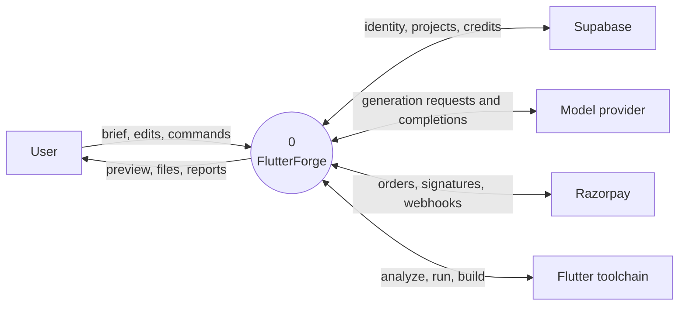

*Figure 4.4 — Data flow diagram, level 0 (context).*

### 4.4.2 Level-1 DFD

Figure 4.5 decomposes the system into seven processes and four data stores. The workspace store (D4) is local to the bridge; the other stores are Supabase tables.

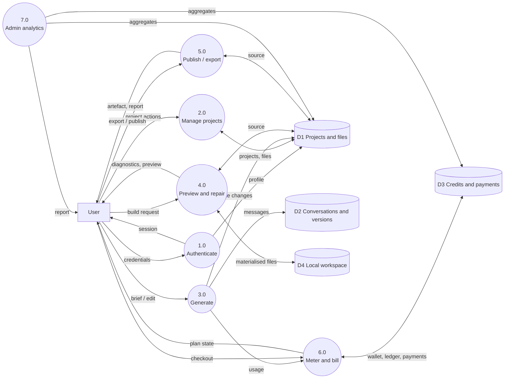

*Figure 4.5 — Data flow diagram, level 1.*

### 4.4.3 Generation process flow

Figure 4.6 expands process 3.0. The request passes through three tiers; the completeness gate rejects a response that cannot possibly build; the result is persisted and handed to the preview.

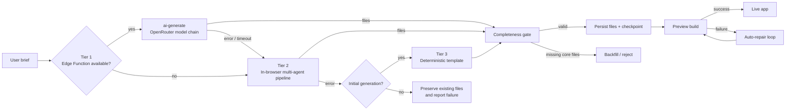

*Figure 4.6 — Generation process flow with tiered fallback.*

### 4.4.4 Preview and repair sequence

Figure 4.7 shows the interaction between the user, the React UI, the Node bridge, the filesystem, the Flutter SDK, and the repair agent. The compile gate is the decision point that determines whether the user sees an application or a repair cycle.

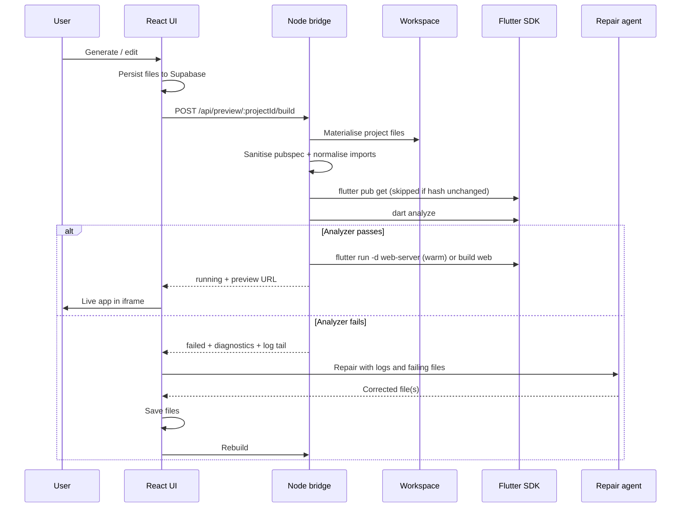

*Figure 4.7 — Preview and self-healing sequence.*

## 4.5 Class / Component Design

Figure 4.8 shows the core classes and their relationships. Stores are Zustand factories; services are plain modules. The project store is the composition root for generation, files, versions, and repair, while the preview store owns build sessions and failure notifications.

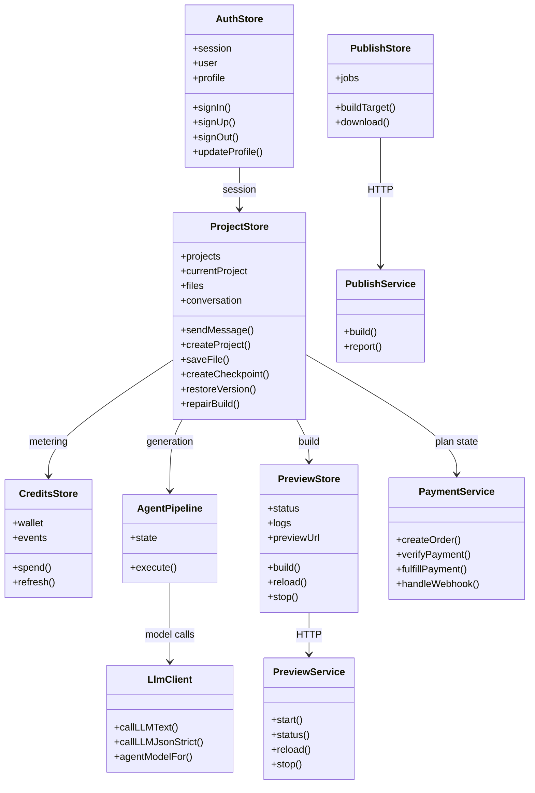

*Figure 4.8 — Class diagram of the core client and server components.*

*Table 4.4 — Key classes and responsibilities.*

| Class / module | Layer | Responsibility |
|---|---|---|
| `AuthStore` | Client | Session lifecycle, profile loading, sign-in/out, password reset |
| `ProjectStore` | Client | Projects, files, conversation, generation orchestration, versions, repair |
| `CreditsStore` | Client | Wallet, allowance, ledger, spend and refresh |
| `PreviewStore` | Client | Build sessions, logs, status polling, auto-repair bridge |
| `PublishStore` | Client | Publish jobs, artefact download |
| `AgentPipeline` | Agent | 13-stage generation over a shared `ProjectState` |
| `LlmClient` | Agent | Model routing, key pool, JSON retry, credit metering |
| `PreviewService` | Server | Materialise, sanitise, analyze, run/build, proxy, stop |
| `PublishService` | Server | Target builds, reports, static hosting |
| `PaymentService` | Server | Orders, HMAC verification, fulfillment, webhooks |

## 4.6 Database Design

### 4.6.1 Entity–relationship model

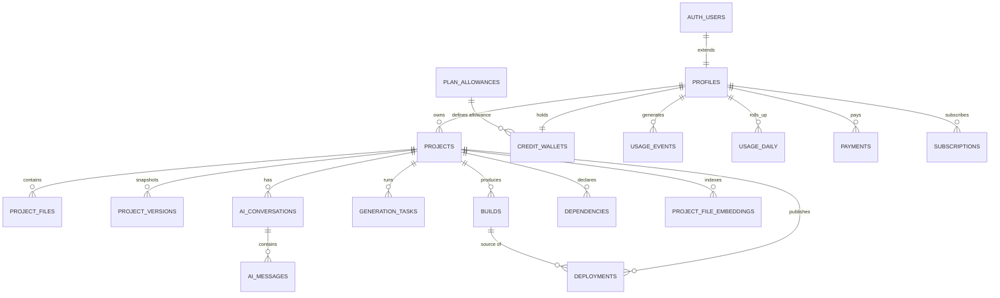

*Figure 4.9 — Entity–relationship diagram.*

`webhook_events` is an independent idempotency ledger, and `code_patterns` is a shared pattern library; neither has a direct foreign key to a user.

### 4.6.2 Table catalogue

*Table 4.5 — Database table catalogue (19 public tables).*

| Table | Purpose | Key columns |
|---|---|---|
| `profiles` | User profile and role | `id`, `email`, `plan`, `role`, `onboarding_state` |
| `projects` | Project metadata | `user_id`, `name`, `platform`, `status`, `is_shared`, `share_slug`, `archived_at` |
| `project_files` | Source files | `project_id`, `path`, `content`, unique `(project_id, path)` |
| `project_versions` | Checkpoints | `version_number`, `file_snapshot` (JSONB) |
| `ai_conversations` | Chat threads | `project_id`, `title` |
| `ai_messages` | Messages | `conversation_id`, `role`, `content`, `changed_files`, `metadata` |
| `generation_tasks` | Generation runs | `task_type`, `status`, `progress`, `steps`, `result` |
| `builds` | Preview/publish builds | `build_type`, `status`, `logs`, `duration_ms` |
| `dependencies` | Dart packages | `package_name`, `version`, `package_type`, `status` |
| `deployments` | Published targets | `url`, `status`, `provider`, `logs` |
| `code_patterns` | Curated UI/code patterns | `domain`, `category`, `code`, `embedding vector(768)` |
| `project_file_embeddings` | Per-file retrieval index | `file_path`, `summary`, `embedding` |
| `plan_allowances` | Plan catalogue | `plan_id`, `monthly_credits`, `price_paise` |
| `credit_wallets` | Credit balance | `user_id`, `balance`, `monthly_allowance`, `cycle_id`, `plan` |
| `usage_events` | Append-only ledger (partitioned monthly) | `user_id`, `kind`, `amount`, `model`, `created_at` |
| `usage_daily` | Daily rollup | `(user_id, day)`, `credits_used`, `calls` |
| `payments` | Razorpay payment audit | `razorpay_order_id` (unique), `amount_paise`, `status`, `signature_verified` |
| `webhook_events` | Webhook idempotency | `event_id` (unique), `event_type`, `payload`, `processed` |
| `subscriptions` | Active plan periods | `plan`, `status`, `period_start`, `period_end`, `cancel_at_period_end` |

### 4.6.3 Indexing and partitioning

*Table 4.6 — Index and partition strategy.*

Postgres was chosen over a document store for two reasons. The data is relational by nature: a project has files, a conversation has messages, and a payment belongs to a subscription. More importantly, row-level security is a Postgres feature with a clear audit trail, and it is the cheapest way to make a multi-tenant table safe. Partitioning matters only once the ledger grows; it is in place now so that the operational step is a scheduled function rather than a migration during an incident.


| Object | Type | Purpose |
|---|---|---|
| `projects_user_updated_idx` | B-tree | Dashboard list ordered by recent activity |
| `projects_user_pinned_idx` | B-tree, nulls last | Pinned projects first |
| `project_files_project_path_unq` | Unique | Deterministic file upserts |
| `ai_messages_conversation_idx` | B-tree | Chat timeline reads |
| `builds_project_created_idx` | B-tree | Build history |
| `deployments_project_created_idx` | B-tree | Deployment history |
| `generation_tasks_project_status_idx` | B-tree | Run monitoring |
| `project_versions_project_number_idx` | B-tree | Restore and diff |
| `projects_share_slug_unq` | Unique partial | One public slug per shared project |
| `projects_name_trgm_idx` | GIN trigram | Fast `ILIKE` name search |
| `usage_events` | Range partitions | Monthly ledger pruning |
| `usage_events_default` | Default partition | Prevents insert failure if a month is missed |
| `usage_daily` | Rollup table | Cheap dashboard aggregation |

`usage_events` is range-partitioned by month. The default partition prevents insert failures if a month is missed, and `create_usage_events_partition(date)` creates future partitions. `usage_daily` keeps dashboard aggregation cheap even when raw events grow to billions.

### 4.6.4 Row-level security

Every user-owned table has RLS enabled. The hardening migration rewrites policies to use `(SELECT auth.uid())`, which PostgreSQL evaluates once per statement as an initplan instead of once per row. This matters for large result sets.

Public share reads are no longer granted by a blanket `is_shared = true` policy. Instead, `get_shared_project(slug)` and `get_shared_project_files(slug)` are `SECURITY DEFINER` functions that return only the requested shared project and its files. This prevents an anonymous client from listing every shared project.

## 4.7 UI / UX Design

### 4.7.1 Route map

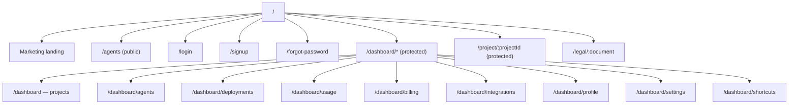

*Figure 4.10 — Application route map.*

*Table 4.7 — Dashboard routes and content.*

| Route | Content |
|---|---|
| `/dashboard` | Workbench: greeting, project/active/latest stats, search, sort, project cards |
| `/dashboard/agents` | Brief composer, examples, Describe/Build/Refine cards, prompt library tabs |
| `/dashboard/deployments` | Deployed apps with workspace and live links |
| `/dashboard/usage` | Balance, plan, allowance, usage bar, credit activity |
| `/dashboard/billing` | Current plan, credits, monthly/annual toggle, Razorpay plan cards |
| `/dashboard/integrations` | Backend, model, payment, and toolchain status |
| `/dashboard/profile` | Name, avatar, email, password reset |
| `/dashboard/settings` | Theme, editor, preview, billing shortcuts, sign-out |
| `/dashboard/shortcuts` | Keyboard reference |

### 4.7.2 Dashboard shell

The dashboard is a full-viewport application shell (`h-[100dvh]`, no outer frame or border). It contains:

- a collapsible sidebar with Platform, Workspace, and Account groups;
- a top bar with breadcrumb, theme toggle, and a “New app” action;
- a content area constrained to a 1440 px measure for readability on ultrawide screens;
- route-driven active states derived from `pathname` and `?sort=`;
- a create-project wizard that can open with a prefilled brief from the landing hero, the agents page, or a prompt-library entry.

### 4.7.3 Workspace

The workspace is a tabbed IDE-like surface with sections for AI Builder, Preview, Files, Dependencies, Code, Terminal, Versions, Settings, and Export. The AI Builder is a full-page chat with Markdown rendering, code blocks, copy buttons, per-file change lists, a collapsible activity card, and a context popover that shows what the model knows. Other tabs keep a compact chat sidebar.

### 4.7.4 Visual language

The product uses a light-first “Studio” visual language: cream paper backgrounds, ink borders, pastel accents, hard offset shadows, and Space Grotesk display type. Dark mode uses charcoal surfaces, low-contrast hairlines, and a warm yellow accent. The UI is built with Tailwind CSS and Radix/Base UI primitives, with Motion for transitions and a reduced-motion path.

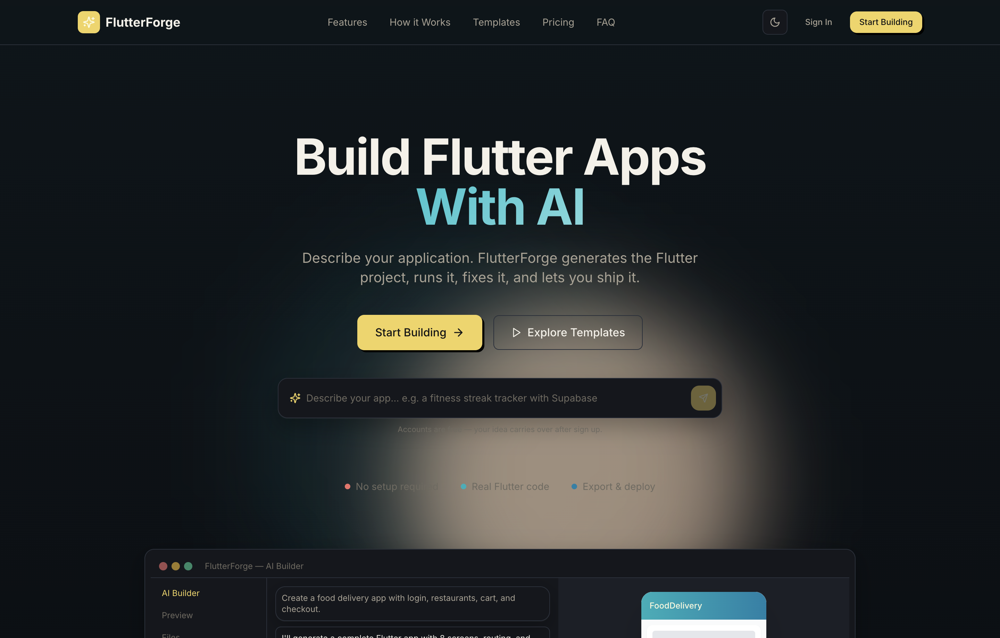

*Figure 4.11 — Dark-mode design language across the landing page and workspace preview.*

## 4.8 Algorithm / Model Design

### 4.8.1 Generation strategy

**Algorithm 4.1 — Tiered generation with a completeness gate**

```text
INPUT : brief, project context, user settings
OUTPUT: file changes and a tier label

1  attempt edge function with the requested model and the free model chain
2  if the response contains a parsable file set then
3      files ← parsed files
4      tier ← "edge"
5  else if an API key is available then
6      files ← run the 13-stage browser pipeline
7      tier ← "browser-pipeline"
8  else if this is the first generation then
9      files ← deterministic template for the chosen backend mode
10     tier ← "template"
11 else
12     abort and preserve existing files
13 gate ← require pubspec.yaml and lib/main.dart, both non-empty
14 if gate fails then
15     backfill core files or reject the response
16 return files, tier, gate
```

### 4.8.2 Model routing

The browser pipeline assigns a tier to each agent. Frontier models handle product reasoning and screen construction; economy models handle mechanical transformations. The server re-checks entitlement before honouring a premium request and downgrades honestly rather than silently failing.

*Table 4.8 — Agent-to-model-tier routing.*

| Agent | Tier | Rationale |
|---|---|---|
| `IntakeAgent` | Frontier | Product reasoning, naming, screen discovery |
| `UXResearchAgent` | Frontier | Journey and priority decisions |
| `DesignSystemAgent` | Economy | Structured token generation |
| `ArchitectureAgent` | Frontier | Folder and dependency decisions |
| `DataModelAgent` | Economy | Schema-shaped output |
| `FeaturePlannerAgent` | Frontier | Feature decomposition |
| `DataModelsAgent` | Economy | Mechanical Dart models |
| `CodeGenAgent` | Economy | Theme, router, services |
| `FrontendBuilderAgent` | Frontier | Highest-value UI code |
| `BackendApiAgent` | Economy | Supabase service and SQL |
| `IntegrationAgent` | Economy | Import and route wiring |
| `AppShellAgent` | Economy | Entry point and navigation shell |
| `QAValidationAgent` | Economy | Deterministic gates plus summaries |
| `RepairAgent` | Economy | Targeted fixes from diagnostics |

### 4.8.3 Preview and repair

**Algorithm 4.2 — Compile-gated preview**

```text
INPUT : project files, preview mode
OUTPUT: live preview or diagnostics

1  materialise files with safeRelativePath
2  sanitise pubspec.yaml and normalise package imports
3  if hash(pubspec) changed or .dart_tool is missing then
4      run flutter pub get
5  diagnostics ← dart analyze
6  if diagnostics contain errors then
7      record failed session with log tail
8      return diagnostics
9  if mode = "run" then
10     reuse a warm web-server runner or spawn one on a free port
11 else
12     run flutter build web --release with the correct base href
13 record running session and preview URL
14 return preview URL
```

**Algorithm 4.3 — Bounded self-repair**

```text
INPUT : failed session, project id
OUTPUT: rebuilt session or a stop message

1  if this session was already handled then return
2  attempts ← attempts(project) + 1
3  if attempts > 3 then
4      tell the user the files are safe and stop
5  else
6      collect log tail and first diagnostics
7      ask the repair agent for corrected files
8      save corrected files
9      start a new preview build
```

### 4.8.4 Credit and payment logic

**Algorithm 4.4 — Atomic credit spend (database function)**

```text
INPUT : amount > 0, kind, label, model
OUTPUT: new balance or "insufficient_credits"

1  ensure the wallet exists and the monthly cycle is current
2  SELECT the wallet row FOR UPDATE
3  if balance < amount then return insufficient_credits
4  balance ← balance - amount
5  lifetime_used ← lifetime_used + amount
6  insert a negative usage_events row
7  upsert usage_daily for the current day
8  commit and return the new balance
```

**Algorithm 4.5 — Razorpay signature verification**

```text
INPUT : order_id, payment_id, signature
OUTPUT: accepted or rejected

1  expected ← HMAC_SHA256(order_id + "|" + payment_id, KEY_SECRET)
2  if length(expected) ≠ length(signature) then reject
3  if not constant_time_equal(expected, signature) then reject
4  accept
```

These five algorithms are the ones with real failure modes. The rest of the system is plumbing: routing, persistence, rendering. Two of them are deliberately conservative. Algorithm 4.3 stops repairing after three attempts rather than continuing to spend quota, and Algorithm 4.1 prefers an honest failure to a response that looks successful but cannot build. Both choices were made after watching the system behave badly in the other direction.

---
# CHAPTER 5 – IMPLEMENTATION

## 5.1 Development Environment

The implementation was developed and tested on the machine described in Table 5.1. The container baseline is Node 20 Alpine, while the local development machine used a newer Node release; the project code targets Node 20+ APIs only.

*Table 5.1 — Development environment.*

| Item | Value |
|---|---|
| Operating system | macOS 27.0 (arm64) |
| Node.js | 26.3.0 (development); Node 20 LTS container baseline |
| npm | 11.16.0 |
| Flutter SDK | 3.47.5 stable |
| Dart | 3.13.4 |
| Git | 2.54.0 |
| Editor | Visual Studio Code / Monaco in-app |
| Browser | Chromium-based browser for UI and preview verification |
| Database | Supabase Postgres with `pgvector` and `pg_trgm` |
| Payments | Razorpay test mode |

*Table 5.2 — Technology stack.*

| Layer | Technology | Version | Role |
|---|---|---|---|
| UI framework | React | 18.3.1 | Component model |
| Language | TypeScript | 5.6.3 | Type safety across client and server |
| Build tool | Vite | 5.4.8 | Dev server, HMR, production bundle |
| Routing | React Router | 7.18 | Nested dashboard routes |
| State | Zustand | 5.0 | Lightweight stores |
| Styling | Tailwind CSS | 3.4 | Utility-first styling |
| Primitives | Radix UI / Base UI | current | Accessible dialogs, menus, tabs |
| Editor | Monaco | 4.7 | Code editing |
| Motion | Motion | 14.x | Transitions and reduced motion |
| Markdown | Streamdown | 2.7 | Streaming chat rendering |
| Backend | Supabase JS | 2.57 | Auth, Postgres, Edge Functions |
| Database | PostgreSQL + pgvector | Supabase managed | Relational data, RLS, vectors |
| Edge runtime | Deno | Supabase Edge | Hosted generation |
| Local bridge | Node.js | 20 LTS+ | HTTP/SSE, workspaces, Flutter |
| Desktop | Electron | 33 | macOS/Windows shell |
| Packaging | electron-builder | 25 | DMG, ZIP, NSIS |
| Payments | Razorpay SDK | 2.9 | Orders, verification, webhooks |
| Output | Flutter / Dart | 3.24+ / 3.4+ | Generated application |
| Frontend tests | Vitest + Testing Library | 2.1 / 16.x | Unit and component tests |
| Server tests | `node:test` + `tsx` | Node 20+ | HTTP/SSE integration tests |

**Setup commands.**

```bash
npm ci                      # install exact dependency versions
npm run server              # Node bridge on :8787
npm run dev                 # Vite UI on :5173, proxying /api to :8787
npm run dev:desktop         # Electron shell with the bridge
npm run typecheck           # TypeScript, no emit
npm run test                # frontend suites
npm run test:server         # server integration suites
npm run build && npm run build:server
```

The interesting part of this environment is not the editor but the Flutter toolchain. Everything the preview service does depends on `flutter` being on the path, and the server discovers it at startup, reports it in `/api/harness/capabilities`, and allows an operator to override it with `FLUTTER_BIN`. Inside a container, where the SDK is not normally installed, the preview switches to release builds, which are slower but do not require a long-lived development server.


## 5.2 Module-wise Implementation

### 5.2.1 Authentication and profile

`src/main.tsx` mounts the application. `App.tsx` restores the persisted theme (`ff-theme`) before rendering to avoid a flash, initialises the Supabase session with a 1.5-second safety timeout, subscribes to `onAuthStateChange`, lazy-loads route pages, and wraps the tree in an `ErrorBoundary`, router, `Suspense`, desktop menu bridge, and toast container.

`ProtectedRoute` redirects unauthenticated users to `/login`; it does not currently preserve the intended destination. `PublicOnlyRoute` prevents signed-in users from seeing the login and signup pages. The auth store manages `session`, `user`, `profile`, `initialized`, sign-in, sign-up, sign-out, profile update, and password reset, and maps Supabase errors to readable messages.

### 5.2.2 Dashboard shell and sections

`DashboardPage.tsx` is a full-screen shell with a collapsible sidebar, breadcrumb, theme toggle, account menu, and nested routes. The sidebar derives its active state from the URL. Sections are real pages under `/dashboard/*` rather than links to the marketing site:

- **Workbench** — greeting, stats, search, sort, project cards.
- **Agents** — brief composer, example starters, Describe/Build/Refine cards, and a prompt library with Update / Restyle / Add / Fix / Ship tabs.
- **Deployments** — projects with a deployment URL or deployed status.
- **Usage** — wallet balance, allowance, cycle progress, lifetime usage, ledger.
- **Billing** — current plan, credits, monthly/annual toggle, Razorpay plan cards.
- **Integrations** — backend, model, payment, and toolchain status.
- **Profile** — display name, avatar, email, password reset.
- **Settings** — theme, editor, preview, billing shortcuts, sign-out.
- **Shortcuts** — keyboard reference.

The mobile create action is an icon in the header rather than a floating button, so it cannot cover content. Navigation from the mobile drawer closes the drawer and keeps the user inside the dashboard.

### 5.2.3 Create-project wizard

`CreateProjectWizard` captures the prompt (with character count and ⌘/Ctrl+Enter), project name, template, Flutter version, state management (`provider`, `riverpod`, `bloc`, `change_notifier`), theme mode, platform, and backend mode (`auto`, `supabase`, `local`). It shows a live read-out of what “Auto” would decide.

On submit it:

1. creates the project row;
2. builds a structured prompt with the backend requirement and quality constraints;
3. navigates to `/project/:id` with the initial prompt in router state;
4. lets the workspace auto-send the first prompt once.

Local-only apps receive an explicit instruction: “Do NOT use Supabase or any backend. Keep state local (`shared_preferences`/Hive if persistence is needed). No SQL, no auth screens, no service layer.” All apps receive: “Generate complete, runnable Flutter code with Material 3, a coherent theme, responsive layouts and every requested feature.”

### 5.2.4 Workspace and AI builder

`WorkspacePage.tsx` owns the tab state and the workspace header. `AIBuilderPanel` renders the chat, streaming tokens, agent timeline, file change lists, retry/copy controls, context popover, and suggested next actions. `handleSend` validates the project and prompt, calls `sendMessage`, updates generation phases, and refreshes files, versions, and preview state when the result arrives.

`sendMessage` handles chat-only turns before generation. For build turns it:

- assembles conversation history and project context;
- calls `requestAIGeneration`;
- applies returned file changes in a batch;
- records a deduplicated checkpoint of the new file state;
- records the assistant message with `changed_files`;
- updates project status and triggers the preview build.

A duplicate-send guard prevents two concurrent generations for the same conversation. Chat classification answers general questions (“what is Supabase?”, “thanks”) without touching files or creating a checkpoint.

### 5.2.5 Hosted edge generation

`supabase/functions/ai-generate/index.ts` is a Deno edge function that:

- resolves CORS from `ALLOWED_ORIGINS`, always allowing localhost for development, and emits `Vary: Origin`;
- accepts `messages`, project context, model, mode (`generate`/`edit`/`chat`), active file, and build errors;
- bounds context to the last 20 files and last 20 turns, truncating each file to 3000 characters;
- tries the requested model first, then a free model chain;
- clamps output tokens for models with lower caps;
- parses files from fenced blocks with `filepath="..."`;
- returns `{ files, model, usage }` or a structured error.

The free chain is ordered as follows: `nvidia/nemotron-3-ultra-550b-a55b:free`, `poolside/laguna-s-2.1:free`, `cohere/north-mini-code:free`, `nvidia/nemotron-3-super-120b-a12b:free`, `google/gemma-4-31b-it:free`, and `nvidia/nemotron-3.5-lightning:free`. The system prompt enforces clean architecture, no stubs, Supabase RLS, Material 3, a theme toggle, real package imports, and complete files.

### 5.2.6 In-browser multi-agent pipeline

`FlutterSupabaseAgent.execute` supports two modes:

- **Surgical edit mode** (`isEdit`): `runEditAgent` receives the existing files and returns only the changed files.
- **Full generation**: `LovableGenerationPipeline.execute` runs the 13 stages and converts the resulting file map into `AgentFileArtifact[]`.

The pipeline uses a `ProjectState` blackboard containing the product brief, design tokens, architecture, schema, feature plan, screen graph, generated files, diagnostics, logs, and repair attempts. Each step catches errors and preserves the previous state, so one failed agent does not destroy the whole run.

*Table 5.3 — Pipeline stages and outputs.*

| # | Stage | Agent | Output |
|---|---|---|---|
| 1 | Product intake | `IntakeAgent` | App name, one-liner, audience, domain, screens, backend need, palette |
| 2 | UX research | `UXResearchAgent` | Journeys, screen priorities, interaction notes |
| 3 | Design system | `DesignSystemAgent` | Material 3 palette, typography, spacing, radius |
| 4 | Architecture | `ArchitectureAgent` | Feature folders, state management, navigation, packages |
| 5 | Database schema | `DataModelAgent` | Tables, columns, relationships, RLS intent |
| 6 | Feature planning | `FeaturePlannerAgent` | Feature list and screen mapping |
| 7 | Dart models | `DataModelsAgent` | Model classes, JSON serialisation, enums |
| 8 | Core code | `CodeGenAgent` | Theme, router, providers, services, shared widgets |
| 9 | Screens | `FrontendBuilderAgent` | Feature screens with loading, error, and empty states |
| 10 | Backend/API | `BackendApiAgent` | Supabase service, auth, repositories, SQL migrations |
| 11 | Integration | `IntegrationAgent` | Route wiring, imports, dependency injection |
| 12 | App shell | `AppShellAgent` | `main.dart`, `app.dart`, navigation shell |
| 13 | QA validation | `QAValidationAgent` | Gate diagnostics for files, entry point, screens, controls, placeholders, Supabase, pubspec |

The QA gates are deterministic:

- **G1** — critical files exist and are non-empty.
- **G2** — `lib/main.dart` calls `runApp`.
- **G3** — `app.dart` uses `MaterialApp`.
- **G4** — at least one screen exists under `lib/features/`.
- **G5** — no `onPressed: null` dead controls; no TODO, placeholder, or coming-soon text.
- **G6** — Supabase imports have a corresponding service or auth service.
- **G7** — `pubspec.yaml` has an SDK constraint.

### 5.2.7 Prompt engineering and project skills

Three layers of instruction are used:

1. **Global system prompt** (edge function) — role, architecture, Supabase rules, UI quality, output format.
2. **Project contract (`AGENTS.md`)** — written into the harness workspace. It tells the model to write files with tools, use relative POSIX paths, produce complete compilable files, keep the package name exact, respect Supabase/local-only mode, use Material 3, avoid shell commands during initial generation, and target desktop-safe packages.
3. **Project skills** — installed under `.dsh/skills`: `modern-flutter-ui`, `flutter-architecture`, `desktop-web-parity`, and `supabase-production` (only when the app uses Supabase).

A design brief is persisted in `.flutterforge/design.json` and rendered into the prompt when present. It captures palette, typography, spacing, radius, component style, and rationale, so edits remain visually consistent. The `app_id` is pinned in `pubspec.yaml`, and stale self-imports are rewritten to the new package name.

### 5.2.8 Pre-write validation

`src/agent/preWriteValidator.ts` fixes failure classes before files reach the project or the compiler:

1. **Invalid Dart package names** — normalised to `^[a-z][a-z0-9_]*$`.
2. **Invalid YAML plain scalars** — quotes descriptions containing `: `, `#`, or quotes.
3. **Hallucinated package imports** — rewrites unknown `package:` imports to the closest existing file or reports an issue.
4. **Missing dependencies** — injects known pub.dev packages with caret ranges when imports require them.
5. **Missing sections** — adds `environment`, `dependencies`, and `flutter` blocks when absent.
6. **Truncation and unresolved imports** — the artifact gate rejects unbalanced braces and unresolved app-namespace imports.

The validator is deterministic: fixes it cannot make confidently are reported as issues, never guessed.

### 5.2.9 Preview service

`server/preview.ts` implements the preview lifecycle:

1. **Materialise** project files into a per-project directory using `safeRelativePath`.
2. **Sanitise `pubspec.yaml`** — quote invalid scalars, repair impossible Dart SDK constraints, drop Flutter pins the installed SDK cannot satisfy, align self-imports with the package name.
3. **Hash the pubspec** and skip `flutter pub get` when the hash and `.dart_tool/package_config.json` are unchanged.
4. **Run `dart analyze`** and normalise diagnostics into file, line, column, severity, code, message, and correction.
5. If analysis passes, **run mode** spawns `flutter run -d web-server` on a free port and registers a warm runner; **build mode** runs `flutter build web --release` with the correct base href and serves `build/web`.
6. **Serve** `/preview/:projectId/*` through a reverse proxy or static handler.
7. **Record** status, bounded logs, diagnostics, and timestamps in an in-memory session map.
8. **Stop** runners on request or when the warm pool exceeds its limit (three by default).

Missing assets are served as a one-pixel PNG, which prevents a broken image from failing an otherwise healthy preview.

Two bugs in this service shaped the final design, and both were found by using the tool rather than by reading it. The first was stale preview state: an earlier session had compiled the starter template, so every new app rendered as the same demo. The fix was to tear down any in-flight build before starting a new one and to rebuild from the freshly generated files. The second was starter-file pollution. A generated calculator once shipped with seventeen files from the template, including a Supabase auth screen the brief never asked for. The store now removes stale starter files before persisting a complete generation, and it keeps them when the brief is local-only.


### 5.2.10 Automatic repair

Two repair paths exist.

**Build-failure repair.** `registerBuildFailedHandler` listens for preview sessions that transition to `failed`. It ignores duplicate notifications, increments a per-project counter, and either calls `repairBuild` (up to three attempts) or stops with a message that the files are safe and can be fixed manually. The repaired files are saved and a new preview build starts.

The budget exists because of what happened without one. A repair that succeeds on the first attempt is the common case; a repair that loops is not. After three failures the system stops, keeps the files as they are, and tells the user what it tried. That message matters more than the repair itself, because it prevents the impression that the tool is still working when it has in fact given up.


**QA repair.** `RepairAgent` runs after the QA stage when diagnostics contain errors. For each failing file it sends the path, error message, and suggestion to the model, requesting only the corrected file content. If the model fails, it performs structural repairs: backfill `lib/main.dart`, a home screen, or a Supabase service, and ensure critical files exist.

### 5.2.11 Versions, dependencies, export, and publishing

- **Versions** — `project_versions` stores a JSONB snapshot per checkpoint. `versionDiff` computes added, removed, and modified files with stable hashes; the UI can restore a checkpoint.
- **Dependencies** — the dependency view lists Dart packages and their status and can add a package to `pubspec.yaml`.
- **ZIP export** — `src/utils/exportProject.ts` uses JSZip to build an archive from project files, preserving paths and adding a README.
- **Publishing** — `server/publish.ts` supports Web (`flutter build web --release`), PWA (web build with manifest and service-worker presence checks), Android (`flutter build apk`), macOS (`flutter build macos`), and Windows (`flutter build windows`). Each build writes a report with target, status, duration, log tail, artefact name, and size. Web builds are served under `/publish/:projectId/`; other artefacts are downloadable.

Generated projects do not include native runner folders for every target. The export adds helper scripts:

```bash
bash tool/create_platforms.sh      # macOS + Windows runners
flutter run -d macos               # or -d windows
flutter build macos --release
flutter build windows --release
```

PowerShell equivalents are provided.

### 5.2.12 Credits, billing, and desktop shell

**Credits.** `src/agents/llmClient.ts` calls `assertCreditsFor` before a model call and `meterLlmCall` after it. Weight is 1 for economy models and 4 for frontier models. The wallet is read through `ensure_cycle()` on the dashboard and usage pages. Metering fails open when Supabase is unavailable, so a local build is not blocked by an infrastructure outage; this is a documented limitation for a hard paywall.

**Billing.** `src/lib/razorpay.ts` lazy-loads Checkout, calls `/api/create-order` with the plan and period, opens the modal with the publishable key, and posts the order, payment, and signature to `/api/verify-payment`. `server/razorpay.ts` resolves prices from a server-side table, creates the order, verifies the HMAC with `timingSafeEqual`, re-fetches the order, and can grant credits through the service-role `grant_plan_credits` RPC. Webhooks are verified with `RAZORPAY_WEBHOOK_SECRET`.

**Desktop.** `electron/main.cjs` creates a single `BrowserWindow` with `contextIsolation: true`, `nodeIntegration: false`, and `sandbox: true`; owns the engine lifecycle (reuse a bridge on `:8787` or spawn one on a random localhost port); stores BYOK keys with Electron `safeStorage` (file mode `0600`); and exposes IPC for folder picking, opening and revealing paths, harness health, vault operations, and visual QA capture. `electron/preload.cjs` exposes only a fixed API and never `ipcRenderer`.

### 5.2.13 DevOps and deployment

**Local development.** Vite proxies `/api`, `/health`, `/preview`, and `/publish` to the bridge (`VITE_HARNESS_DEV_URL`, default `http://127.0.0.1:8787`). The bridge and the UI can be started separately (`npm run server`, `npm run dev`) or together for desktop (`npm run dev:desktop`).

**Container.** The Dockerfile is a two-stage build. The web stage installs dependencies with `ELECTRON_SKIP_BINARY_DOWNLOAD=1` and runs `npm run build`. The runtime stage uses Node 20 Alpine, copies `dist` and `server`, exposes `8787`, and defines a health check against `/health`. A named volume holds `/data` for workspaces, previews, and the managed Flutter SDK. In containers, `FLUTTERFORGE_PREVIEW_MODE=build` is the recommended mode because a warm `flutter run` server is intended for a developer machine.

**Configuration.** `.env.local` is git-ignored and `.env.local.example` documents every variable. Only the Supabase URL, Supabase anon key, and Razorpay publishable key are `VITE_*`; provider keys, the Razorpay secret, and the webhook secret remain server-side.

**Scripts.** `dev`, `dev:server`, `dev:desktop`, `build`, `build:server`, `build:desktop`, `dist:mac`, `dist:win`, `typecheck`, `test`, `test:server`, `check`, and `lint`.

**Desktop packaging.** `electron-builder` packages the Vite `dist`, the compiled server, and the Electron files. macOS targets are DMG and ZIP for arm64 and x64; Windows is NSIS x64. Server files are unpacked from ASAR so child processes can run. The current installers are not code-signed.

### 5.2.14 Privacy and legal surfaces

The in-app legal page explains:

- Supabase stores project metadata, source files, chat messages, dependencies, version snapshots, builds, and deployments.
- AI requests may leave the device and be processed by DeepSeek or OpenRouter under their terms.
- Preview builds send project source and configured Supabase build values to the preview compiler.
- The desktop bridge exposes limited folder operations, not unrestricted filesystem access.

This transparency matters for a tool that handles source code and model prompts.

## 5.3 Important Algorithms / Logic

### 5.3.1 Path containment

Every file write and read passes through `safeRelativePath` and `resolveInside` in `server/harness/workspace.ts`. The function rejects absolute paths, drive letters, NUL bytes, `..` segments, and `.flutterforge` bookkeeping, then verifies that the resolved path stays under the workspace root.

**Listing 5.1 — Path containment.**

```ts
export function safeRelativePath(input: string): string {
  if (typeof input !== 'string' || input.trim() === '') {
    throw new UnsafePathError('File path must be a non-empty string.');
  }
  const normalized = input.replaceAll('\\', '/').replace(/^\.\/+/, '').trim();
  if (normalized.includes('\0')) throw new UnsafePathError('File path contains a NUL byte.');
  if (normalized.startsWith('/') || /^[a-zA-Z]:\//.test(normalized) || normalized.startsWith('//')) {
    throw new UnsafePathError(`File path must be relative: ${input}`);
  }
  const segments = normalized.split('/').filter((segment) => segment !== '' && segment !== '.');
  if (segments.length === 0) throw new UnsafePathError(`File path is empty: ${input}`);
  if (segments.some((segment) => segment === '..')) {
    throw new UnsafePathError(`File path escapes the workspace: ${input}`);
  }
  if (segments.some((segment) => segment === '.flutterforge')) {
    throw new UnsafePathError('File path targets FlutterForge bookkeeping.');
  }
  return segments.join('/');
}
```

### 5.3.2 YAML scalar repair

`server/harness/pubspecFix.ts` repairs the most common `pubspec.yaml` failures before analysis. The scalar fix targets the single most common LLM typo: an unquoted description that contains `": "`, which makes the whole file unparseable. Unparsable SDK constraints are replaced with a safe range; Flutter pins that the installed SDK cannot satisfy are dropped; valid files are returned unchanged.

**Listing 5.2 — Plain-scalar repair (simplified from `fixInvalidPlainScalars`).**

```ts
const fixed = content.split(/\r?\n/).map((line) => {
  const match = line.match(/^([ \t]*)([A-Za-z0-9_.-]+):[ \t]+(.*?)[ \t]*$/);
  if (!match) return line;
  const [, indent, key, raw] = match;
  if (/^['"|[>{&*]/.test(raw)) return line;   // already quoted or structured
  if (!/:\s/.test(raw)) return line;          // no YAML-breaking colon
  return `${indent}${key}: '${raw.replace(/'/g, "''")}'`;
}).join('\n');
```

### 5.3.3 Duplicate-send guard

A module-level set records in-flight conversations. A second send for the same conversation returns a `duplicate` result instead of launching a parallel generation. The guard is released in `finally`, so a failed request cannot deadlock the chat.

**Listing 5.3 — Duplicate-send guard.**

```ts
const inFlightSends = new Set<string>();

if (inFlightSends.has(conv.id)) {
  onProgress?.('Generation already in progress — ignoring duplicate send.');
  return { mode: 'duplicate' as const };
}
inFlightSends.add(conv.id);
set({ generatingIn: projectId });
return runBody().finally(() => {
  inFlightSends.delete(conv.id);
  set({ generatingIn: null });
});
```

### 5.3.4 Incremental edit checkpoint

After generated changes are persisted and reloaded, the store records a version snapshot. The snapshot hash suppresses duplicates, so a repair that changes nothing does not create checkpoint noise. Only added, modified, and deleted paths are stored in the assistant message metadata.

**Listing 5.4 — Deduplicated checkpoint after an edit.**

```ts
const files = get().files.filter((file) => !file.is_directory);
const snapshot = snapshotProjectFiles(files);
const hash = snapshotHash(snapshot);
const latest = get().versions[0];

if (latest && snapshotHash(latest.file_snapshot ?? {}) === hash) return true;
return get().createVersion(
  projectId,
  checkpointLabel,                       // e.g. "Edited: add expiry reminders"
  `${changedFiles.length} files changed`,
);
```

### 5.3.5 Model routing and key pool

`src/agents/llmClient.ts` orders models by role. `src/agent/keyPool.ts` maintains the browser key pool from environment variables or local storage, marks failing keys with a 30-second cooldown, and rotates across healthy keys. `server/harness/dsh.ts` decides whether a key is an OpenRouter key or a native DeepSeek key; it never sends an OpenRouter model id to a native DeepSeek endpoint. The server re-checks entitlement and downgrades rather than failing silently.

**Listing 5.5 — Route selection.**

```ts
export function resolveModelRoute(input: { apiKey?: string; model?: string }) {
  const apiKey = (input.apiKey ?? '').trim();
  const requestedModel = (input.model ?? '').trim();
  const openRouter = apiKey.startsWith('sk-or-') || (!apiKey && requestedModel.includes('/'));
  const managedAccount = !openRouter && !apiKey && !process.env.DEEPSEEK_API_KEY;
  const requestedForRoute = !openRouter && requestedModel.includes('/') ? '' : requestedModel;
  const model = sanitizeModelId(
    requestedForRoute || (openRouter ? DEFAULT_OPENROUTER_MODEL : DEFAULT_DEEPSEEK_MODEL),
    openRouter ? DEFAULT_OPENROUTER_MODEL : DEFAULT_DEEPSEEK_MODEL,
  );
  return {
    provider: openRouter ? 'openrouter' : (managedAccount ? 'deepseek-account' : 'deepseek-official'),
    model,
    apiKeyEnv: openRouter ? 'OPENROUTER_API_KEY' : 'DEEPSEEK_API_KEY',
  };
}
```

### 5.3.6 Credit metering

`meterLlmCall` derives a weight from the model id and calls the wallet RPC. Metering failures are logged, never thrown, because a build must not fail because the ledger is temporarily unavailable.

**Listing 5.6 — Credit weight and fail-open metering.**

```ts
function defaultCreditWeight(modelId?: string | null): number {
  if (!modelId) return 1;
  const id = modelId.toLowerCase();
  if (/ultra|70b|deepseek-chat|qwen/.test(id)) return 4;
  return 1;
}

async function meterLlmCall(model: string, label: string): Promise<void> {
  const weight = defaultCreditWeight(model);
  try {
    const result = await useCreditsStore.getState().spend(weight, 'llm_call', label, model);
    if (!result.ok) console.warn('[credits] deduction refused:', result.error);
  } catch (cause) {
    console.warn('[credits] metering failed:', cause);
  }
}
```

### 5.3.7 Publish report

`server/publish.ts` resolves the target, runs the Flutter command with a timeout, records the bounded log tail, verifies that the artefact exists, and writes a JSON report. For PWA it additionally checks for `manifest.json` and `flutter_service_worker.js` and records a note rather than failing the build.

**Listing 5.7 — Publish report shape.**

```ts
const report = {
  target,                         // web | pwa | android | macos | windows
  label,
  status: 'succeeded',
  startedAt,
  durationMs,
  fileCount,
  analyzer: { skipped, summary, errors, warnings },
  artifact: { kind, name, bytes, entries },
  publicPath,
  notes,
};
```

## 5.4 Database / API Implementation

### 5.4.1 Apply order

A fresh Supabase project is initialised with:

1. `supabase/full_schema.sql` — base tables, indexes, triggers, vector functions, RLS.
2. `supabase/migrations/20261115_001_hardening.sql` — constraints, hot-path indexes, RLS rewrite, shared RPCs.
3. `20261115_002_credits.sql` — plan catalogue, wallets, partitioned ledger, rollups, RPCs, backfill.
4. `20261115_003_billing.sql` — payments, subscriptions, webhook idempotency table, `record_payment`.
5. `20261115_004_admin_ops.sql` — admin role, overview, top consumers, recent payments, retention, expiry.

`20261115_ALL_IN_ONE.sql` concatenates 001–004 for convenience but assumes the base schema exists. All migrations are idempotent and safe to re-run.

### 5.4.2 Credit and payment functions

**`ensure_cycle()`** is idempotent: if the wallet's `cycle_id` is not the current UTC month, it resets the balance to the monthly allowance, clears cycle usage, and appends a `cycle_reset` ledger row.

**`spend_credits(amount, kind, label, model)`** validates a positive amount, ensures the cycle, locks the wallet row with `FOR UPDATE`, returns `insufficient_credits` when the balance is too low, updates the balance and lifetime usage, inserts a negative usage event, and updates the daily rollup.

**`grant_plan_credits(user, plan, extra)`** is service-role only. It reads the allowance from `plan_allowances`, creates the wallet if needed, sets the balance to the allowance plus any extra, updates the plan and lifetime purchased amount, and writes a `grant_plan` event.

**`record_payment(...)`** is service-role only and atomic: it inserts or updates a payment row with `signature_verified = true`, upserts an active subscription, updates `profiles.plan`, calls `grant_plan_credits`, and returns the payment, subscription, period end, and new balance. The unique partial index `subscriptions_one_active_per_user_idx` guarantees one active subscription per user.

**Administration.** `is_admin()` checks `profiles.role = 'admin'`. Admin RPCs return aggregate users, projects, active subscriptions, paid payments, revenue in paise, credits spent, and LLM calls. `prune_usage_events_before` deletes old raw events, and `expire_lapsed_subscriptions` marks expired subscriptions.

### 5.4.3 HTTP API

*Table 5.4 — Node bridge HTTP API.*

| Method | Endpoint | Purpose |
|---|---|---|
| `GET` | `/health` | Runtime and engine health |
| `GET` | `/api/harness/health` | Alias with capability detail |
| `GET` | `/api/harness/capabilities` | Runtime, profile, route, Flutter, desktop targets |
| `POST` | `/api/harness/stream` | SSE generation through the DeepSeek Harness engine |
| `GET` | `/api/harness/session/:projectId` | Current workspace snapshot |
| `DELETE` | `/api/harness/session/:projectId` | Delete workspace and session |
| `GET` | `/api/harness/workspace?project_id=…` | Workspace path |
| `POST` | `/api/analyze/:projectId` | Run diagnostics without building |
| `GET`/`POST`/`DELETE` | `/api/credentials` | BYOK status, set, remove (server-side) |
| `POST` | `/api/terminal/run` | Allow-listed command in the workspace |
| `POST` | `/api/preview/:projectId/build` | Start warm preview or static build |
| `GET` | `/api/preview/project/:projectId/status` | Latest preview status and logs |
| `GET` | `/api/preview/:sessionId/status` | Poll one preview session |
| `POST` | `/api/preview/:sessionId/stop` | Stop a preview |
| `POST` | `/api/preview/project/:projectId/reload` | Reload a warm runner |
| `GET` | `/preview/:projectId/*` | Serve or reverse-proxy the preview |
| `POST` | `/api/publish/:projectId/build` | Build a publish target |
| `GET` | `/api/publish/project/:projectId/status` | Publish status |
| `GET` | `/api/publish/project/:projectId/report` | Build report |
| `GET` | `/api/publish/project/:projectId/artifact` | Download artefact |
| `GET` | `/publish/:projectId/*` | Serve a published web build |
| `POST` | `/api/create-order` | Razorpay order with server-side price |
| `POST` | `/api/verify-payment` | HMAC-SHA256 signature verification |
| `POST` | `/api/payments/fulfill` | Verified payment → `grant_plan_credits` RPC |
| `POST` | `/api/razorpay/webhook` | `payment.captured` webhook, raw body |
| `POST` | `/api/supabase/verify` | Optional Supabase Management API check |
| `POST` | `/api/supabase/apply-migration` | Optional SQL migration application |

### 5.4.4 SSE event contract

*Table 5.5 — Server-sent event contract.*

| Event | Payload | Meaning |
|---|---|---|
| `agent_event` | `{ node, phase, message, stepNumber, totalSteps, thought?, activeFile? }` | Human-readable progress |
| `token` | `{ node, token, phase }` | Streamed text |
| `file_ready` | `{ path, content, action, language, node }` | A file was created or modified |
| `files_merged` | `{ count, paths }` | Batch persistence completed |
| `validation` | `{ is_valid, summary, issue_count }` | Validation result |
| `done` | `{ success, fileCount, sessionId, workspace, summary }` | Turn complete |
| `error` | `{ message, code }` | Failure |

## 5.5 Security Implementation

*Table 5.6 — Security threats and controls.*

| Threat | Control |
|---|---|
| Unauthorised project access | Supabase Auth JWT and RLS on every user-owned table; `ProtectedRoute` on the client |
| Service-role key leakage | Service-role key exists only in server or edge secrets; never in `VITE_*` variables |
| Provider key leakage | OpenRouter and DeepSeek keys stay server-side or in the Electron OS-encrypted vault; never in the Vite bundle |
| Payment tampering | Server resolves prices from `PLAN_PRICES`; the client amount is ignored for plan purchases |
| Forged payment success | HMAC-SHA256 over `order_id` and `payment_id` with `timingSafeEqual`; mismatch returns 400 |
| Duplicate webhook grant | `webhook_events.event_id` unique and `payments.razorpay_order_id` unique are available in the schema; the current handler verifies signatures but does not yet persist webhook events |
| Double credit spend | `spend_credits` locks the wallet row with `FOR UPDATE` and checks the balance before update |
| Client wallet tampering | No client INSERT or UPDATE policy on `credit_wallets`; only security-definer RPCs write |
| Path traversal | `safeRelativePath` rejects absolute paths, `..`, NUL bytes, and `.flutterforge` bookkeeping; `resolveInside` verifies containment |
| Command injection | Terminal allow-list (`flutter`, `dart`, `ls`, `pwd`, `cat`, `git`, `help`, `clear`) with argument validation |
| Renderer privilege escalation | Electron `contextIsolation: true`, `nodeIntegration: false`, `sandbox: true`, fixed preload channels |
| Cross-origin abuse of the edge function | `ALLOWED_ORIGINS` exact list; localhost allowed only for development; `Vary: Origin` |
| Oversized request bodies | 64 MB body limit on the bridge |
| Shared-project enumeration | Blanket anon `is_shared` policy removed; security-definer RPCs return one slug at a time |
| Stale profile writes | Profile write-lock migration and guarded triggers |

The design follows least privilege and the OWASP ASVS guidance for authentication, access control, input validation, and sensitive-data protection.

Two entries in Table 5.6 are not fully implemented, and they are listed here rather than hidden. The webhook handler verifies signatures but does not yet write to `webhook_events`, so a replayed event is not detected by a database constraint. And the payment verification path is complete while the entitlement step that follows it is not called by the client. Both are described in Section 8.2.


## 5.6 Screens / User Interface

The screenshots below were captured from the running application with a seeded demonstration account and mocked read-only fixtures for projects and credits. They document the interface and layout, not production usage.

### 5.6.1 Dashboard workbench

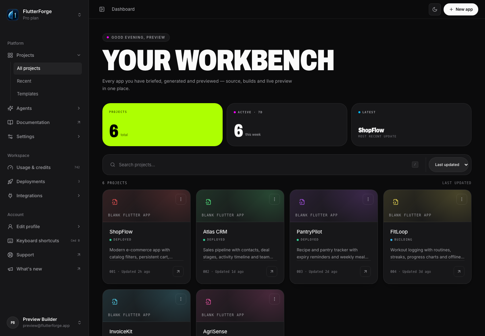

*Figure 5.1 — Dashboard workbench with project statistics, search, sort, and project cards.*

### 5.6.2 Agents inside the studio

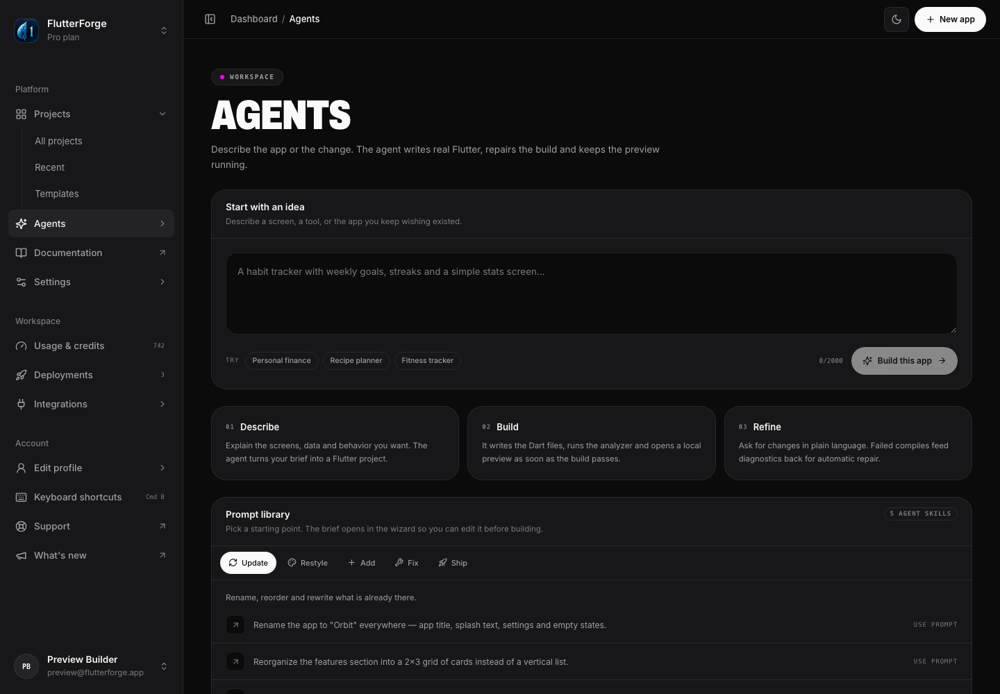

*Figure 5.2 — Embedded agents page with a brief composer, workflow guidance, and prompt library.*

### 5.6.3 Plans and billing

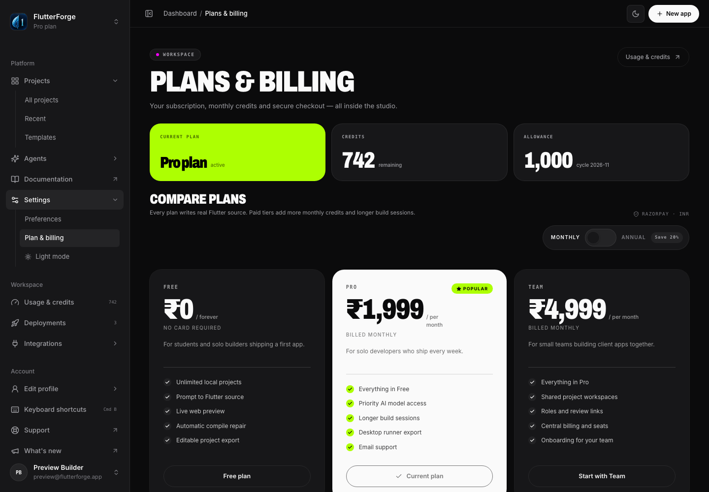

*Figure 5.3 — Billing section with the current plan, credits, billing period toggle, and Razorpay plan cards.*

### 5.6.4 Usage and credits

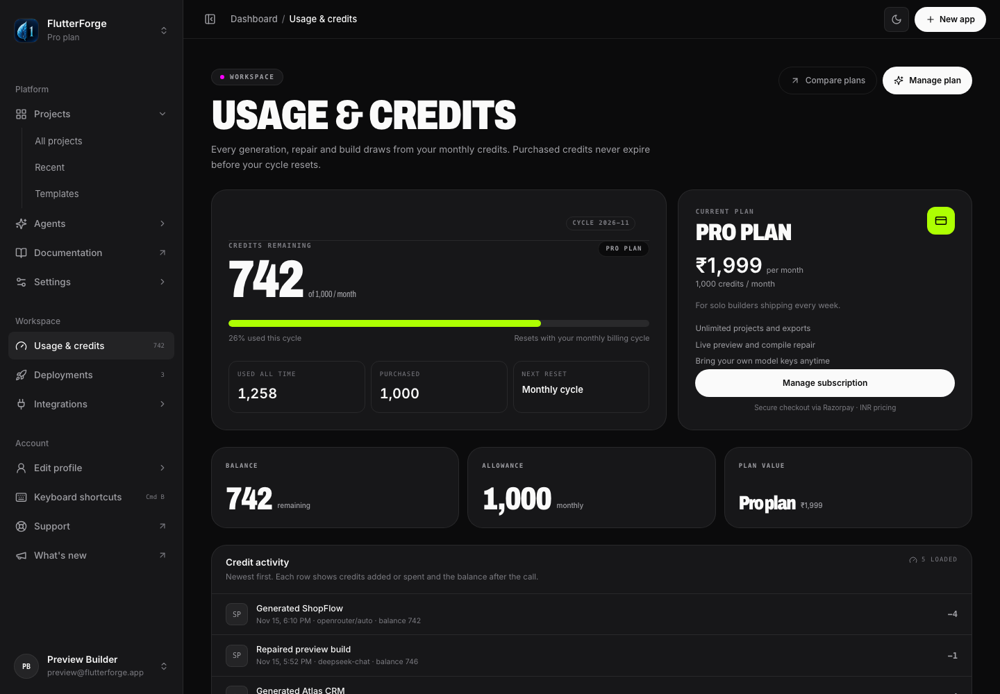

*Figure 5.4 — Usage page with balance, allowance, cycle progress, lifetime usage, and the credit ledger.*

### 5.6.5 Deployments

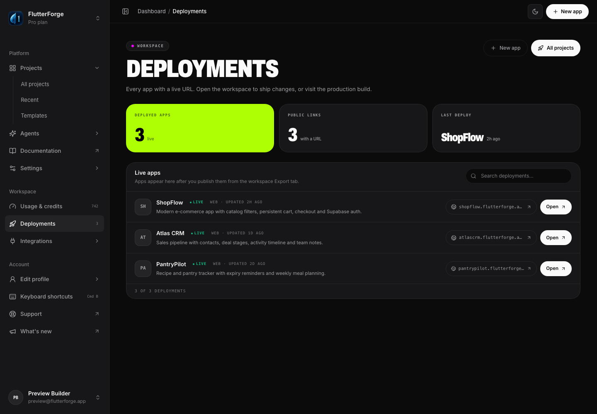

*Figure 5.5 — Deployments page listing published apps with workspace and live links.*

### 5.6.6 Integrations

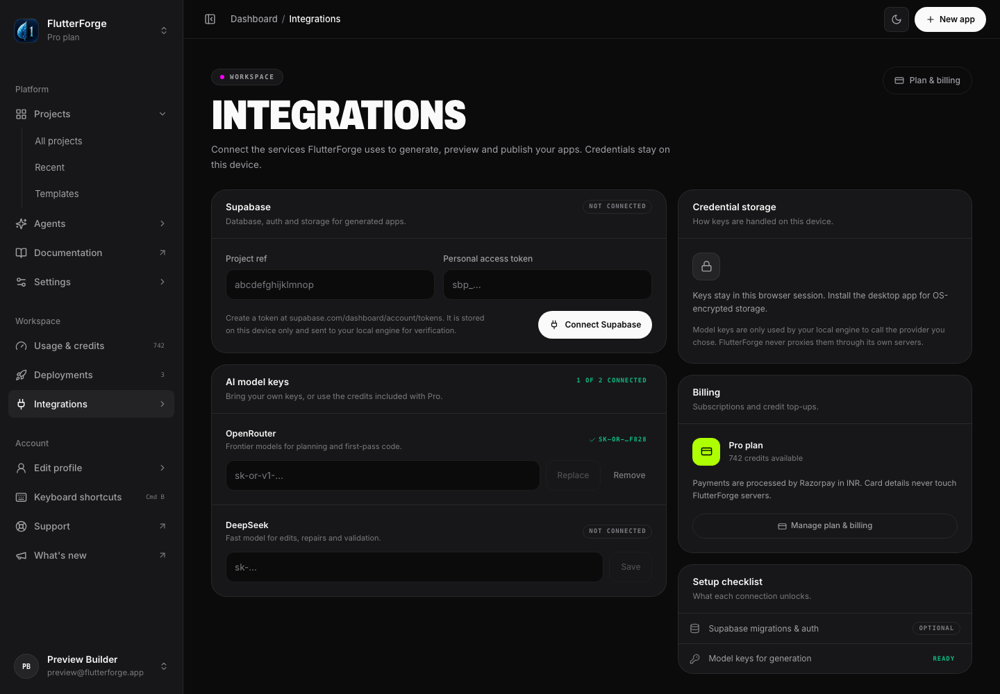

*Figure 5.6 — Integrations page showing backend, model, payment, and toolchain status.*

### 5.6.7 Profile

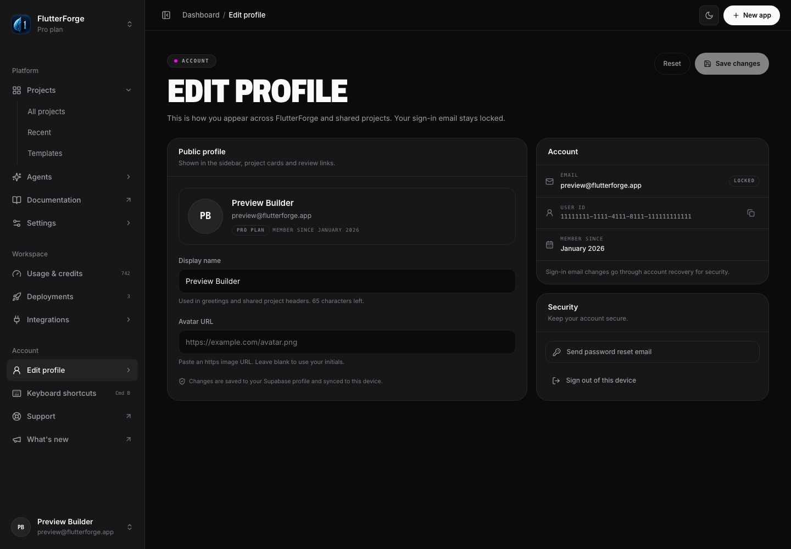

*Figure 5.7 — Profile page with display name, avatar, email, and password reset.*

### 5.6.8 Settings

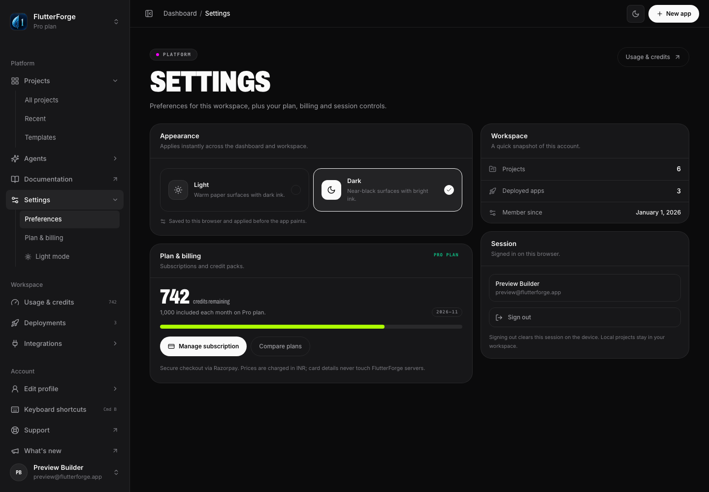

*Figure 5.8 — Settings page with theme, editor, preview, billing, and account controls.*

### 5.6.9 Shortcuts

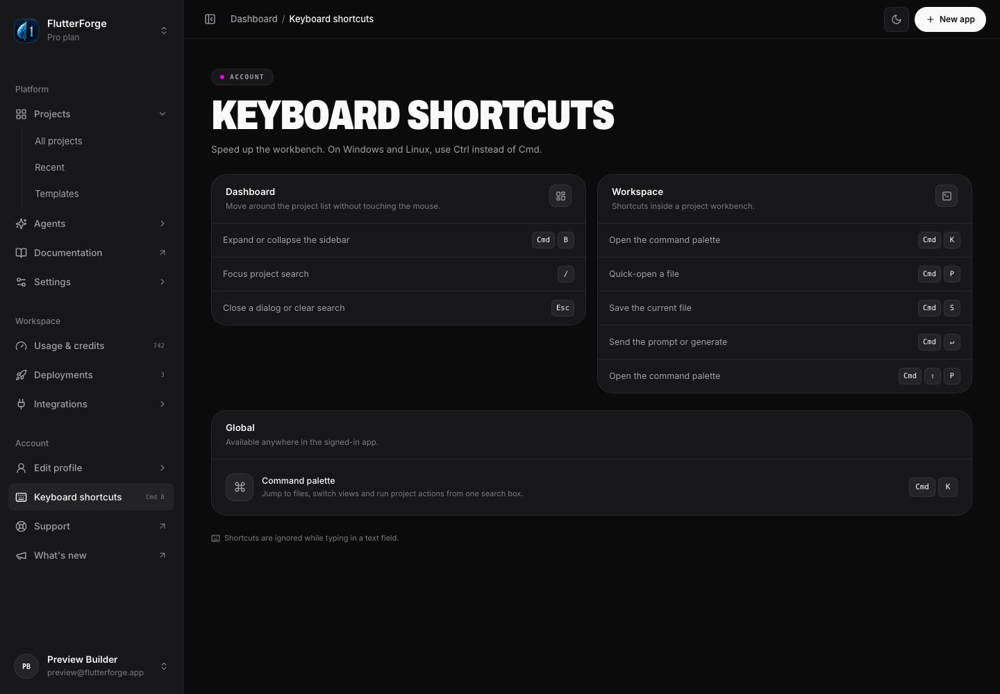

*Figure 5.9 — Keyboard shortcut reference inside the dashboard.*

### 5.6.10 Responsive layouts

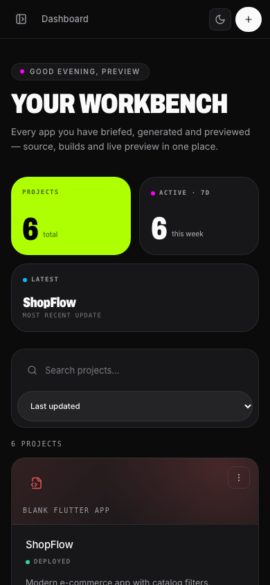

*Figure 5.10 — Projects workbench at a 390 × 844 mobile viewport.*

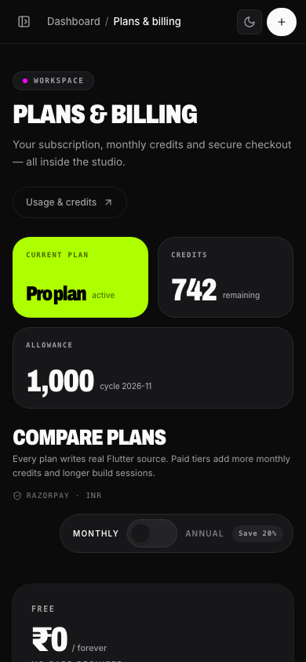

*Figure 5.11 — Billing section at a 390 × 844 mobile viewport.*

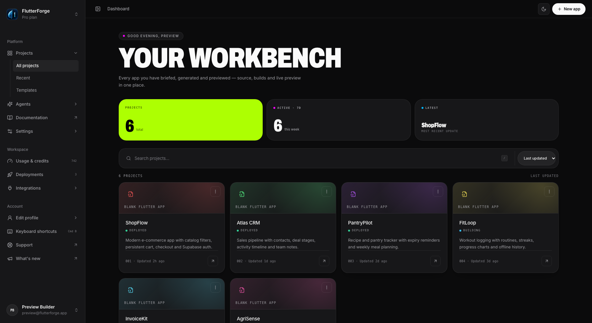

*Figure 5.12 — Wide layout: the shell is edge-to-edge while content is capped at 1440 px.*

### 5.6.11 Responsive verification summary

The layouts above were checked at three widths: 390 × 844 (mobile), 1440 × 1000 (desktop), and 1830 × 1000 (wide). At mobile width the sidebar becomes a drawer and the create action moves into the header; at 1440 px the shell is full-screen with no outer frame; at 1830 px the content remains capped at 1440 px while the shell stays edge-to-edge.

---
# CHAPTER 6 – TESTING AND VALIDATION

## 6.1 Testing Strategy

The project uses a layered strategy rather than chasing line coverage. The goal is **high-value coverage of failure-prone boundaries**: schema validation, pubspec repair, path safety, workspace diffing, generation streaming, preview compilation, publishing, payments, and dashboard navigation.

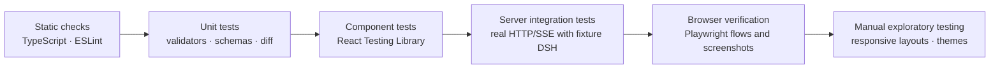

*Figure 6.1 — Layered testing strategy.*

*Table 6.1 — Test levels, tools, and scope.*

| Level | Tool | Scope | Count |
|---|---|---|---|
| Static analysis | `tsc --noEmit`, ESLint | Type errors, unused symbols, unsafe patterns | Whole repository |
| Unit | Vitest | Validators, schema coercion, version diff | 25 |
| Component | Vitest + Testing Library | Dashboard sections, sidebar, wizard, AI builder, workspace | 39 |
| Server integration | `node:test` + `tsx` | HTTP, SSE, workspace isolation, preview, publish, routing | 46 |
| Browser | Playwright + mocked Supabase fixtures | Navigation, deep links, responsive layout | 8 scenarios |
| Manual | Browser and desktop | Theme, keyboard, layout, error states | Exploratory |

## 6.2 Test Cases

The tests target the places where the system is most likely to break: a path that escapes the workspace, a pubspec that will not parse, a model response that is missing a file, a sidebar that sends the user to the wrong route. Coverage of pure presentation code is lower on purpose. A component test that only asserts that a button renders tells the reader little, and it is the kind of test that passes while the feature is broken.


*Table 6.2 — Functional test cases.*

| ID | Module | Test description | Expected result | Type | Result |
|---|---|---|---|---|---|
| TC-01 | Dashboard | Render the workbench with seeded projects | Stats and project cards appear; search and sort are usable | Manual | Pass |
| TC-02 | Deployments | List only projects with a deployment URL or deployed status | Non-deployed projects are excluded; links are correct | Automated | Pass |
| TC-03 | Deployments | Render with no deployed projects | Empty state with guidance is shown | Automated | Pass |
| TC-04 | Usage | Show balance, plan, allowance, and recent activity | Values match the wallet fixture | Automated | Pass |
| TC-05 | Usage | Choose “Manage subscription” | Navigates to `/dashboard/billing` inside the dashboard | Automated | Pass |
| TC-06 | Billing | Show the current plan and plan cards | Current plan is marked; checkout actions remain in the dashboard | Automated | Pass |
| TC-07 | Sidebar | Render Platform, Workspace, and Account groups | All three groups and their items are present | Automated | Pass |
| TC-08 | Sidebar | Follow each section link | Each link targets its own `/dashboard/*` route | Automated | Pass |
| TC-09 | Sidebar | Mark the active section | `aria-current="page"` follows the URL, including `?sort=` | Automated | Pass |
| TC-10 | Agents | Open Agents from the sidebar | Stays on `/dashboard/agents`; composer and library render | Manual | Pass |
| TC-11 | Prompt library | Choose a library entry | Wizard opens with the exact brief prefilled | Automated | Pass |
| TC-12 | Wizard | Submit a brief | Project and initial prompt are passed to the workspace | Automated | Pass |
| TC-13 | Wizard | Force a create failure | Error is shown and the form is unlocked for retry | Automated | Pass |
| TC-14 | AI Builder | Stream a response | Tokens render before the send request resolves | Automated | Pass |
| TC-15 | AI Builder | Run a generation | Timeline, sources, queue, and terminal update live | Automated | Pass |
| TC-16 | Workspace | Open a missing project id | Redirects to the dashboard instead of crashing | Automated | Pass |
| TC-17 | Profile | Save name and avatar | Profile row updates and the UI reflects the change | Automated | Pass |
| TC-18 | Profile | Submit an invalid avatar URL | Validation blocks the save and explains why | Automated | Pass |
| TC-19 | Profile | Request a password reset | Reset call is issued for the signed-in email | Automated | Pass |
| TC-20 | Settings | Switch theme | Theme changes and persists in `localStorage` | Automated | Pass |
| TC-21 | Shortcuts | Open the shortcut reference | Dashboard and workspace shortcuts are listed | Automated | Pass |
| TC-22 | Server | Request a path containing `../` | Request is rejected before the stream opens | Integration | Pass |
| TC-23 | Server | Stream a generation with fixture DSH | SSE events and files are produced; session is recorded | Integration | Pass |
| TC-24 | Server | Pin a package name in the brief | Generated `pubspec.yaml` uses the requested name | Integration | Pass |
| TC-25 | Server | Send an edit to an existing workspace | Persisted session is reused; project is retained | Integration | Pass |
| TC-26 | Server | Run a disallowed terminal command | Command is rejected with a helpful message | Integration | Pass |
| TC-27 | Server | Build and serve a preview | Compile gate passes; app is served from the same origin | Integration | Pass |
| TC-28 | Server | Publish a web target | Bundle is built, hosted, and a report is written | Integration | Pass |
| TC-29 | Server | Reset a project workspace | Workspace directory is deleted and recreated cleanly | Integration | Pass |
| TC-30 | Versioning | Diff two snapshots | Added, removed, and modified files are reported with stable hashes | Unit | Pass |
| TC-31 | Validator | Feed malformed pubspec and imports | Fixes are applied; unsafe changes are reported, not guessed | Unit | Pass |
| TC-32 | Schema | Send malformed agent JSON | Coercion and one corrective retry produce valid output | Unit | Pass |
| TC-33 | Mobile | Navigate from the drawer | Route changes and the drawer closes | Manual | Pass |
| TC-34 | Billing | Deep link `/dashboard/settings#billing` on mobile | Billing section scrolls into view | Manual | Pass |
| TC-35 | Layout | Open at 1830 × 1000 | Shell is edge-to-edge; content is capped at 1440 px | Manual | Pass |

*Table 6.3 — Security test cases.*

| ID | Threat | Test | Expected result | Result |
|---|---|---|---|---|
| ST-01 | Path traversal | Submit `../../etc/passwd` as a file path | Rejected with `UnsafePathError` | Pass |
| ST-02 | Absolute path | Submit `/tmp/evil.dart` | Rejected as non-relative | Pass |
| ST-03 | NUL byte | Submit a path containing `\0` | Rejected | Pass |
| ST-04 | Bookkeeping access | Submit `.flutterforge/session.json` | Rejected | Pass |
| ST-05 | Command injection | Run `rm -rf /` in the terminal panel | Rejected by the allow-list | Pass |
| ST-06 | Forged payment | Send a mismatched Razorpay signature | HTTP 400; payment is not accepted | Pass |
| ST-07 | Secret leakage | Request the routing configuration | Response contains the provider and model but never the key | Pass |
| ST-08 | Cross-user reads | Query another user's projects under RLS | Zero rows returned | Reviewed |
| ST-09 | Privilege escalation | Call `record_payment` or `grant_plan_credits` as a normal user | `insufficient_privilege` | Reviewed |
| ST-10 | Cross-origin abuse | Call the edge function from an unlisted origin | No `Access-Control-Allow-Origin` is returned | Reviewed |

## 6.3 Test Results

### 6.3.1 Frontend suites

Command: `npm run test` (Vitest). Wall time on the development machine: **5 seconds**. Result: **64 passed / 64**.

*Table 6.4 — Frontend test suites.*

| Test file | Tests | Coverage focus |
|---|---:|---|
| `src/agent/preWriteValidator.test.ts` | 11 | YAML scalars, package names, imports, dependencies, truncation gate |
| `src/agents/schema.test.ts` | 10 | Schema coercion, missing keys, nested paths, retry behaviour |
| `src/components/ui/sidebar.test.tsx` | 8 | Collapse/expand, persistence, keyboard, mobile drawer, render-prop links |
| `src/features/dashboard/DashboardSidebar.test.tsx` | 7 | Route links, active state, billing, counts, external links |
| `src/features/dashboard/sections/Sections.test.tsx` | 13 | Deployments, usage, billing, profile, settings, shortcuts, agents |
| `src/components/landing/PromptLibrary.test.tsx` | 5 | Full prompt use, copy, focus restoration, reduced motion |
| `src/utils/versionDiff.test.ts` | 4 | Added/removed/modified files, line counts, stable hashes |
| `src/features/dashboard/CreateProjectWizard.test.tsx` | 2 | Generation handoff, failure and retry |
| `src/features/workspace/AIBuilderPanel.test.tsx` | 2 | Streaming tokens, activity timeline |
| `src/pages/WorkspacePage.test.tsx` | 2 | Missing project redirect, workspace header |
| **Total** | **64** | **10 files, all passing** |

Notable behaviours verified:

- The sidebar derives active state from the URL and distinguishes “All projects” from “Recent”.
- Agents and Plans & billing open inside `/dashboard`, not the marketing site.
- A prompt-library entry opens the wizard with the exact brief.
- The pricing block marks the current plan and keeps the free-plan link inside the dashboard.
- The workspace redirects to the dashboard when a project is missing.
- Streaming chat tokens render before the send request finishes.

The integration suite runs against a fixture harness rather than a real language model. That choice was made so the tests stay fast, deterministic and free, but it has a cost: the event projection and workspace isolation are tested, while the prompt engineering itself is not. Nothing in the suite proves that a model produces a better app, because no test can.


### 6.3.2 Server suites

Command: `npm run test:server` (`node:test` with `tsx`). Wall time: **14 seconds**. Result: **46 passed / 46, 0 failed**.

*Table 6.5 — Server test suites.*

| Test file | Focus |
|---|---|
| `server/test/dsh.test.ts` | Runtime discovery, profile generation, route selection, key handling |
| `server/test/normalize.test.ts` | Package alignment, Supabase artefact pruning |
| `server/test/pubspecFix.test.ts` | SDK and Flutter constraints, YAML scalar repair, valid-file preservation |
| `server/test/routing.test.ts` | Frontier/economy routing, entitlement downgrade, stored keys, secret stripping |
| `server/test/server.test.ts` | Health, SSE generation, package pinning, session reuse, path escape rejection, terminal, preview, publish, reset |
| `server/test/skills.test.ts` | Skill installation, conditional Supabase skill |
| `server/test/workspace.test.ts` | Safe paths, diff snapshots, code-block recovery, project validation |

The integration suite drives the real HTTP and SSE surface with a fixture DSH, so it verifies workspace isolation, path-traversal rejection, event projection, session reuse, and reset without spending model tokens. The preview test builds and serves an app from the same origin; the publish test builds a web bundle, hosts it, and writes a build report.

### 6.3.3 Static analysis and production build

*Table 6.6 — Static analysis and build results.*

| Check | Command | Result |
|---|---|---|
| TypeScript | `npm run typecheck` | Clean, 0 errors (7 s) |
| Frontend tests | `npm run test` | 64 passed / 64 |
| Server tests | `npm run test:server` | 46 passed / 46 |
| Production build | `npm run build` | Success in 13 s (Vite 11.99 s) |
| Bundle size | `du -sh dist` | ≈18 MB, 462 files |
| Bundle composition | `find dist -type f` | 448 JS chunks, 3 CSS, 8 WebP, 1 PNG, 1 HTML |

The Vite chunk-size warning is expected for a Monaco-based IDE bundle. Lazy loading of pages and manual chunking are the next optimisation steps.

### 6.3.4 Browser-level verification

A Playwright script (maintained outside the repository in a temporary harness) drove the running app with mocked Supabase REST fixtures.

*Table 6.7 — Browser-level verification.*

| Scenario | Expected | Result |
|---|---|---|
| Sidebar “Agents” | Stay on `/dashboard/agents`; render composer and library | Pass |
| Prompt-library entry | Open wizard with the exact brief | Pass (brief matched) |
| Usage → “Manage subscription” | Navigate to `/dashboard/billing`; show current plan | Pass |
| Sidebar “Plan & billing” | Route to `/dashboard/billing`; `aria-current="page"` | Pass |
| Mobile drawer navigation | Navigate and close the drawer | Pass |
| Deep link `/dashboard/settings#billing` | Scroll billing into view | Pass (`scrollTop` 509; section top 80) |
| Desktop layout at 1440 × 1000 | Full-screen shell, no outer frame | Pass |
| Wide layout at 1830 × 1000 | Content capped at 1440 px, sidebar intact | Pass |

## 6.4 Performance Evaluation

*Table 6.8 — Measured performance on the development machine.*

| Metric | Value | Notes |
|---|---:|---|
| Frontend test suite | 5 s | 64 tests across 10 files |
| Server test suite | 14 s | 46 tests, including real preview and publish builds |
| TypeScript check | 7 s | `tsc --noEmit` |
| Production build | 13 s | Vite 11.99 s |
| Production bundle | 18 MB / 462 files | Monaco, icons, media, and lazy chunks |
| Preview integration (build + serve) | 3.68 s | Fixture app in the server suite |
| Publish integration (web build + host) | 2.76 s | Fixture app in the server suite |
| Warm preview dependency step | Skipped when `pubspec.yaml` hash is unchanged | Reuses `.dart_tool` and `pubspec.lock` |
| Generation time (observed) | ≈60 s for a focused 6–10 file app | Development observation, not a controlled benchmark |

Performance design choices:

- **Warm runners.** A preview session stays alive and is reused on subsequent edits, so the Flutter web server does not cold-start for every change.
- **Dependency hashing.** `flutter pub get` is skipped when the pubspec hash and package config are unchanged.
- **Bounded logs.** Preview and publish logs keep only a tail, avoiding unbounded memory growth.
- **Indexed reads.** Dashboard lists use `(user_id, updated_at)`; chat uses `(conversation_id, created_at)`; files use the unique `(project_id, path)` index.
- **Initplan RLS.** `(SELECT auth.uid())` is evaluated once per statement rather than once per row.
- **Partition pruning.** Monthly `usage_events` partitions keep ledger scans bounded; `usage_daily` serves dashboards.
- **Batched writes.** Generated files are upserted in one request rather than one round-trip per file.
- **Model routing.** Economy models handle edits, repairs, and mechanical stages; frontier models handle intake, architecture, and screens.

The report does **not** claim a load-tested 10-million-user result. Partitioning, rollups, indexes, and pooling guidance are a design posture; a production deployment would additionally require object storage for file bodies, `ai_messages` partitioning, connection pooling, and per-user engine quotas.

## 6.5 Validation Against Objectives

The timings in Table 6.8 were measured on the development machine with a warm Flutter cache, so they are indicative rather than benchmark-grade. The 3.68 second preview and 2.76 second publish figures come from the integration suite, where the project is small and the pub cache is already populated. A cold build in a fresh container takes considerably longer, and the report says so in Section 8.2 rather than quoting the fastest number as typical.


*Table 6.9 — Objective validation matrix.*

| Objective | Success criterion | Evidence | Status |
|---|---|---|---|
| O1 Prompt-to-project | Complete project with package, entry point, theme, routing, screens, models | Edge function, 13-stage pipeline, template; schema and validator tests | Achieved |
| O2 Tiered reliability | Degradation instead of zero files | Three tiers plus completeness gate; routing tests | Achieved |
| O3 Self-healing preview | Bounded repair from real diagnostics | Preview compile gate; build-failure handler; 3-attempt budget | Achieved |
| O4 Persistence and security | RLS, credits, payments in Postgres | Migrations 001–004; 19 tables; policy review | Achieved (billing write path partial) |
| O5 Studio workflow | Dashboard, editor, preview, terminal, versions, export, publish | Routed sections; 64 frontend tests; browser verification | Achieved |
| O6 Desktop delivery | Sandboxed Electron app | `main.cjs`, preload bridge, builder targets | Achieved (unsigned) |
| O7 Subscription billing | Server-authoritative orders, HMAC, credits | `server/razorpay.ts`, SQL functions, ST-06 | Partial (fulfillment not called by UI) |
| O8 Verifiable quality | Tests, type-check, reproducible build | 110 tests, 0 failures, 0 type errors, clean build | Achieved |

---

# CHAPTER 7 – RESULTS AND DISCUSSION

## 7.1 Results

The results are best read as a set of working claims rather than a scorecard. Each row in Table 7.1 names a capability that can be opened, used and inspected in the repository. The rows marked *Partial* are not hedges; they are the two places where the design is complete but the wiring is not, and they are described in detail in Section 8.2.


*Table 7.1 — Functional outcomes.*

| Capability | Status | Evidence |
|---|---|---|
| Prompt-to-Flutter generation | Implemented | Edge function, 13-stage pipeline, deterministic template |
| Optional Supabase scaffolding | Implemented | Backend mode detection; schema and RLS rules |
| Live Flutter web preview | Implemented | Warm `flutter run -d web-server`; compile gate |
| Automatic repair | Implemented | Build-failure handler; 3-attempt budget |
| File editor and explorer | Implemented | Monaco and project store |
| Version checkpoints and diff | Implemented | `project_versions`, `versionDiff` |
| Terminal | Implemented | Allow-listed commands in the workspace |
| ZIP export | Implemented | JSZip export |
| Publish Web/PWA/Android/macOS/Windows | Implemented (toolchain-dependent) | `server/publish.ts`, build reports |
| Dashboard sections | Implemented | Routed pages and 64 tests |
| Agents page and prompt library | Implemented | `/dashboard/agents` |
| Supabase RLS and credits | Implemented | Migrations 001–002 |
| Razorpay checkout and verification | Implemented | Server order and verify; test mode |
| Plan entitlement unlock | Partial | Fulfill endpoint and RPC exist; UI does not call fulfill |
| Public share UI | Partial | Security-definer RPCs exist; client page not built |
| Electron desktop shell | Implemented | macOS/Windows packaging configuration |
| Code signing and auto-update | Not implemented | Documented limitation |

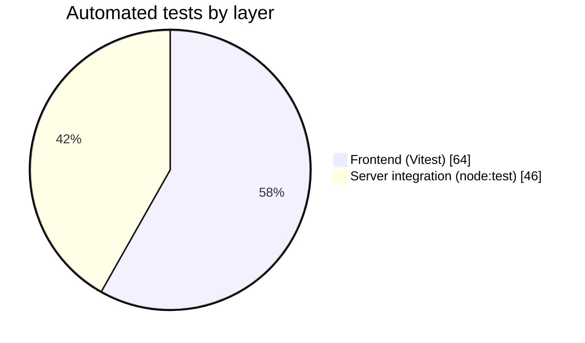

*Figure 7.1 — Distribution of the 110 automated tests.*

## 7.2 Comparison with Existing / Baseline Approach

The baseline for comparison is the **deterministic template generator alone** — the path the system uses when no model is available. It always produces a buildable starting point but does not adapt to the brief. Table 7.2 compares that baseline with FlutterForge's full pipeline and with commercial tools.

*Table 7.2 — Comparison with the baseline and existing tools.*

| Criterion | Template baseline | FlutterForge (full pipeline) | Lovable | FlutterFlow |
|---|---|---|---|---|
| Brief-specific output | No | Yes, when a model is available | Yes | Partial |
| Compiles without manual fixes | Yes | Yes, after the compile gate | Usually | Yes |
| Compiler feedback in the loop | No | Yes (`dart analyze`) | Build logs | Visual validation |
| Automatic repair | No | Yes, bounded to 3 attempts | Limited | No |
| Optional Supabase schema and RLS | Yes, fixed | Yes, generated per brief | Partial | Firebase rules |
| Live preview | Yes | Yes | Yes | Yes |
| Export ownership | Yes | Yes | GitHub sync | Yes |
| Desktop packaging | No | Electron + Flutter targets | No | Limited |
| Billing | No | Razorpay INR + credits | Stripe | External |

FlutterForge is not a feature-for-feature replacement for mature commercial tools. Its contribution is the **Flutter-native, compiler-driven, self-hostable** combination, with an honest degradation path when models are unavailable.

## 7.3 Discussion

### 7.3.1 Reliability

The tiered design was the first decision that felt necessary rather than clever. A single-provider system is one expired key away from being unable to help the user at all. Splitting generation across an edge function, a browser pipeline and a template means the user always gets something, and the difference between tiers is visible in the UI rather than hidden. The completeness gate matters just as much. A model can return a confident response that contains no `pubspec.yaml`, and without that check the user would be looking at an error from a tool that had just reported success.

The template path is the honest floor of the system. It does not adapt to the brief, but it compiles. When a quota runs out mid-demo, that is the difference between a working tool and an embarrassing one.

### 7.3.2 Performance

The first build dominates. `flutter pub get` downloads packages, `dart analyze` parses the whole project, and the web compiler produces the bundle. Reusing `.dart_tool`, `pubspec.lock` and the build directory removes most of that work on the next edit, and hashing the pubspec means `pub get` is skipped entirely when nothing changed. A focused app was observed generating in roughly a minute on a fast model and producing 6 to 10 files. That number is a development observation, not a controlled benchmark, and it moves with the model and the host.

Keeping the bridge local is what makes the warm path possible at all. Uploading a project for every edit would add a round trip and a queue before the compiler even started.

### 7.3.3 Security

The strongest property is also the simplest to state: the browser never holds a secret that can move money or read someone else's data. Row-level security is the boundary for data, the service role never leaves the server, the Razorpay secret is server-side, signatures are compared in constant time, and the Electron renderer is sandboxed.

The cost of that posture is a decision that a hard paywall would reverse. Credit metering fails open when Supabase is unreachable, so a local build is never blocked by an infrastructure problem. That is the right choice for a development tool and the wrong choice for a commercial one, and Section 8.2 records it as a limitation.

### 7.3.4 Maintainability

The code is split by responsibility rather than by technology: pages, features, stores, agents, orchestrator, server harness, preview, publish, billing and Electron. The tests sit at the boundaries, which is where the interesting failures live. The clearest weakness is the size of `project.store.ts`. It holds generation orchestration, file state and version history together, and extracting the orchestration into its own service would make both easier to reason about.

Naming is consistent enough to be a feature. `features/<feature>/{data,domain,presentation}` on the client and `server/<service>.ts` on the bridge means a new file has an obvious home, and the tests are named after the module they protect.

### 7.3.5 User experience

The dashboard work started from a complaint rather than a design brief. Sidebar entries opened the marketing site or a placeholder, so a user who clicked "Billing" left the product. The sections are now real routes under `/dashboard`, and the shell stays in place. The full-screen layout and the 1440 px content measure keep long tables readable on wide monitors.

Mobile needed a different decision. A floating action button covered content at 390 px, so the create action moved into the header, and the drawer closes itself after navigation so the user is not left looking at an empty panel.


## 7.4 User / Expert Feedback

A short feedback instrument was prepared for the final demonstration. The instrument covers the criteria in Table 7.3 on a five-point Likert scale (1 = strongly disagree, 5 = strongly agree), with space for open comments. Table 7.4 is the reporting format; the bracketed cells are to be filled from the actual review panel and should not be presented as collected data until they are.

*Table 7.3 — Feedback instrument.*

| # | Statement | Criterion |
|---|---|---|
| Q1 | The purpose of the tool was clear from the landing page. | Clarity |
| Q2 | Creating a project from a brief was easy. | Usability |
| Q3 | The generated project structure was understandable. | Code quality |
| Q4 | The live preview made it easier to judge the result. | Feedback loop |
| Q5 | The repair messages were understandable when a build failed. | Error handling |
| Q6 | The dashboard sections felt like part of one product. | Consistency |
| Q7 | The interface was usable on a phone-sized screen. | Responsiveness |
| Q8 | The billing and credit information was easy to find. | Transparency |
| Q9 | I would use this tool to start a real project. | Usefulness |
| Q10 | Overall satisfaction with the prototype. | Satisfaction |

*Table 7.4 — Feedback summary (to be completed after the final demonstration).*

| Item | Value |
|---|---|
| Number of reviewers | [n] |
| Reviewer roles | [guide, faculty, peers, external] |
| Mean score, Q1–Q5 | [mean] / 5 |
| Mean score, Q6–Q10 | [mean] / 5 |
| Overall mean | [mean] / 5 |
| Most frequent strength | [comment] |
| Most frequent suggestion | [comment] |
| Actions taken | [change made in response] |

**Instructions for the final submission.** Run the instrument with at least five reviewers (the guide, two faculty members, and two peers). Report the mean and the range rather than only the average, record verbatim comments in an annexure, and describe the changes made in response. The three themes most likely to appear, based on the limitations in Section 8.2, are the value of the live preview, the clarity of the activity timeline, and the incomplete payment-to-plan flow; verify each against the actual responses rather than assuming them.

---

# CHAPTER 8 – CONCLUSION AND FUTURE SCOPE

## 8.1 Conclusion

FlutterForge demonstrates that a prompt-to-application tool can be more than a code generator. By combining a tiered generation pipeline, a real Flutter compiler in the loop, a bounded self-healing mechanism, a secure Supabase data layer, and a complete studio interface, the project turns a natural-language brief into an editable, previewable, exportable application.

The project achieved its main objectives:

- **Generation:** a brief becomes a Flutter project with a valid package, entry point, theme, routing, screens, and optional Supabase schema.
- **Reliability:** three generation tiers and a completeness gate prevent empty or unusable projects.
- **Self-healing:** compiler diagnostics drive targeted repairs, bounded to three attempts.
- **Security:** RLS, security-definer RPCs, server-authoritative pricing, HMAC verification, path safety, and a sandboxed desktop bridge protect users and payments.
- **Studio workflow:** dashboard, agents, preview, editor, terminal, versions, export, and publish are integrated.
- **Quality:** 110 automated tests, a clean type-check, and a successful production build.

The work also exposes honest gaps: live generation depends on external keys; payment entitlement is not fully wired; public sharing is partial; native preview and signing are future work; and the 10-million-user posture is a design target rather than a measured result. These gaps define a concrete roadmap.

From an engineering-education perspective, the project brings together distributed systems, compiler tooling, multi-agent AI, database security, payment integration, desktop packaging, and human-centred interface design. The most valuable lesson is that **probabilistic generation must be surrounded by deterministic verification**: schemas, analyzers, tests, and database constraints are what make AI output dependable.

## 8.2 Limitations

The limitations are stated in the order a reader would meet them. The first two affect the live product; the rest affect the claims the report can make.

1. **Live generation is externally dependent.** The system needs a Supabase project, an OpenRouter key or DeepSeek account, and network access. Without them, only the deterministic template path is available.
2. **Plan entitlement is not fully wired.** `/api/verify-payment` verifies the signature, and `/api/payments/fulfill` can grant credits, but the frontend does not call fulfill after verification. The fulfill path and webhook call `grant_plan_credits` rather than `record_payment`, so payment and subscription rows are not written. A successful payment therefore does not automatically unlock the plan in the current build.
3. **Webhook operations require a public URL.** Razorpay cannot deliver `payment.captured` to a laptop-local bridge without a tunnel or deployed endpoint.
4. **Public sharing is partial.** The database exposes secure RPCs, but the React share page has not been migrated to call them.
5. **Preview is Flutter web.** Native macOS/Windows preview requires running Flutter on that OS; the web iframe is not a native window.
6. **Toolchains are not bundled.** Flutter is discovered or downloaded; Android and iOS builds need additional SDKs and licences. Windows packaging was not tested on real Windows hardware in this environment.
7. **No code signing or auto-update.** Gatekeeper and SmartScreen warnings are expected.
8. **Free model quotas are shared.** The browser key pool rotates across the keys the user provides; when none is healthy, generation falls through to the deterministic template path instead of claiming success.
9. **One generation per project.** Concurrent requests receive a conflict; there is no queue.
10. **Credits fail open.** Metering does not block a local build when Supabase is unavailable; a hard paywall would require the opposite policy.
11. **The 10-million-user posture is a design target, not a load-test result.** Partitioning, rollups, indexes, and pooling guidance exist, but no million-user benchmark was run.
12. **A legacy smoke script references a removed validator.** `scripts/smoke-test.ts` is not part of the test pipeline and should be repaired or removed.
13. **The local harness generation route is implemented and integration-tested, but the web client's default generation path is the edge function plus browser pipeline.** Unifying them behind one adapter is future work.
14. **No third-party penetration test or accessibility audit.** Security and accessibility claims are based on design review and automated checks.

## 8.3 Future Scope

The list below is ordered by how much it would change the product, not by how easy it is. The first four items close gaps that are already visible in this report.

1. **Unify generation behind a provider adapter.** Route edge, harness, browser, and template generation through one interface with health checks and quotas.
2. **Complete payment entitlements.** Call `/api/payments/fulfill` after verification, route fulfillment through `record_payment` so payments and subscriptions are persisted, deploy the webhook, record webhook events for idempotency, and add renewal, cancellation, and reconciliation flows.
3. **Build the public share page.** Use `get_shared_project` and `get_shared_project_files`, add expiry and revocation.
4. **Scale the data layer.** Move `project_files.content` to object storage, partition `ai_messages`, add connection pooling, read replicas, and retention jobs; publish load-test results.
5. **Add a generation queue.** Replace the per-project lock with a durable job queue, worker pool, and progress recovery after refresh.
6. **Native build farm.** Containerised workers for Android, macOS, and Windows with signed artefacts and artefact retention.
7. **Team collaboration.** Workspaces, roles, comments, and real-time presence.
8. **Evaluation harness.** Measure compile success rate, time-to-first-preview, number of repair attempts, and user-rated design quality across a benchmark of briefs.
9. **Observability.** Structured logs, OpenTelemetry traces, error reporting, and cost dashboards per model and per user.
10. **Desktop hardening.** Code signing, notarisation, auto-update, and a Windows CI runner.
11. **Accessibility and localisation.** WCAG audit, keyboard-only flows, screen-reader labels, and RTL support.
12. **Retrieval-augmented generation.** Activate the vector store for pattern retrieval and project-aware context selection.

---

# REFERENCES

[1] M. Chen, J. Tworek, H. Jun, et al., “Evaluating Large Language Models Trained on Code,” *arXiv:2107.03374*, 2021.

[2] E. Nijkamp, B. Pang, H. Hayashi, et al., “CodeGen: An Open Large Language Model for Code with Multi-Turn Program Synthesis,” *International Conference on Learning Representations (ICLR)*, 2023.

[3] T. X. Olausson, J. P. Inala, C. Wang, J. Gao, A. Solar-Lezama, “Is Self-Repair a Silver Bullet for Code Generation?,” *International Conference on Learning Representations (ICLR)*, 2024.

[4] Google, “Flutter documentation,” https://docs.flutter.dev/, accessed 2026.

[5] Google, “Dart documentation,” https://dart.dev/guides, accessed 2026.

[6] Supabase, “Supabase documentation: Auth, Row Level Security, Edge Functions,” https://supabase.com/docs, accessed 2026.

[7] Supabase, “pgvector: vector similarity search,” https://supabase.com/docs/guides/database/extensions/pgvector, accessed 2026.

[8] PostgreSQL Global Development Group, “PostgreSQL documentation: Table Partitioning,” https://www.postgresql.org/docs/current/ddl-partitioning.html, accessed 2026.

[9] PostgreSQL Global Development Group, “PostgreSQL documentation: Row Security Policies,” https://www.postgresql.org/docs/current/ddl-rowsecurity.html, accessed 2026.

[10] Razorpay, “Standard Checkout integration documentation,” https://razorpay.com/docs/payments/payment-gateway/web-integration/standard/, accessed 2026.

[11] Razorpay, “Webhooks documentation,” https://razorpay.com/docs/webhooks/, accessed 2026.

[12] OpenRouter, “API documentation,” https://openrouter.ai/docs, accessed 2026.

[13] DeepSeek, “DeepSeek Harness documentation,” https://github.com/deepseek-ai, accessed 2026.

[14] Meta Open Source, “React documentation,” https://react.dev/, accessed 2026.

[15] Vite, “Vite documentation,” https://vitejs.dev/guide/, accessed 2026.

[16] OWASP Foundation, “OWASP Application Security Verification Standard (ASVS),” https://owasp.org/www-project-application-security-verification-standard/, accessed 2026.

[17] OWASP Foundation, “OWASP Top 10,” https://owasp.org/www-project-top-ten/, accessed 2026.

[18] Electron, “Electron documentation: Security,” https://www.electronjs.org/docs/latest/tutorial/security, accessed 2026.

[19] Microsoft, “Monaco Editor documentation,” https://microsoft.github.io/monaco-editor/, accessed 2026.

[20] Zustand, “Zustand documentation,” https://zustand.docs.pmnd.rs/, accessed 2026.

[21] R. C. Martin, *Clean Architecture: A Craftsman's Guide to Software Structure and Design*. Prentice Hall, 2017.

[22] E. Gamma, R. Helm, R. Johnson, J. Vlissides, *Design Patterns: Elements of Reusable Object-Oriented Software*. Addison-Wesley, 1994.

[23] I. Sommerville, *Software Engineering*, 10th ed. Pearson, 2015.

[24] IEEE, “ISO/IEC/IEEE 29148:2018 — Systems and software engineering — Life cycle processes — Requirements engineering,” 2018.

[25] FlutterFlow, “FlutterFlow documentation,” https://docs.flutterflow.io/, accessed 2026.

[26] Lovable, “Lovable documentation,” https://docs.lovable.dev/, accessed 2026.

[27] StackBlitz, “Bolt documentation,” https://support.bolt.new/, accessed 2026.

[28] Vercel, “v0 documentation,” https://v0.dev/docs, accessed 2026.

[29] Google, “Firebase Studio documentation,” https://firebase.google.com/docs/studio, accessed 2026.

[30] NIST, “Secure Software Development Framework (SSDF) SP 800-218,” 2022.

---

# APPENDICES

## Appendix A — User Manual / Installation Guide

### A.1 Prerequisites

- Node.js 20 LTS or newer and npm 10+.
- Flutter 3.24+ with web support enabled (`flutter config --enable-web`).
- A Supabase project with Auth and Postgres enabled.
- Optional: an OpenRouter key or DeepSeek account for hosted generation.
- Optional: a Razorpay test account for billing.

### A.2 Install

```bash
git clone <repository-url>
cd flutterforge
npm ci
cp .env.local.example .env.local
```

Edit `.env.local` and set at least:

```bash
VITE_SUPABASE_URL=https://<project-ref>.supabase.co
VITE_SUPABASE_ANON_KEY=<anon-key>

OPENROUTER_API_KEY=<server-only-key>
DEEPSEEK_API_KEY=<server-only-key>

RAZORPAY_KEY_ID=<test-key-id>
RAZORPAY_KEY_SECRET=<test-key-secret>
RAZORPAY_WEBHOOK_SECRET=<webhook-secret>
VITE_RAZORPAY_KEY_ID=<test-key-id>
```

Never prefix a secret with `VITE_`; those values are bundled into the browser.

### A.3 Prepare the database

Open the Supabase SQL editor and run, in order:

1. `supabase/full_schema.sql`
2. `supabase/migrations/20261115_001_hardening.sql`
3. `supabase/migrations/20261115_002_credits.sql`
4. `supabase/migrations/20261115_003_billing.sql`
5. `supabase/migrations/20261115_004_admin_ops.sql`

The migrations are idempotent. Verify with the queries in `docs/DATABASE_SETUP.md`.

### A.4 Run

```bash
npm run server       # terminal 1: bridge on http://127.0.0.1:8787
npm run dev          # terminal 2: UI on http://127.0.0.1:5173
```

For the desktop shell:

```bash
npm run dev:desktop
```

For Docker:

```bash
docker compose up --build
```

### A.5 First project

1. Sign up or sign in.
2. Click **New app** in the dashboard header.
3. Type a brief, for example: “A pantry tracker with inventory, expiry reminders, a grocery list, and a weekly meal view.”
4. Choose platform, state management, theme, Flutter version, and backend mode.
5. Submit and wait for the generation phases to finish.
6. Open **Preview** to compile and view the app.
7. Use **Code**, **Files**, **Versions**, **Export**, or **Publish** as needed.

### A.6 Troubleshooting

| Symptom | Likely cause | Action |
|---|---|---|
| Preview stuck at “building” | First `flutter pub get` is downloading packages | Wait; check the preview log tail |
| “Flutter not found” | SDK missing from `PATH` | Set `FLUTTER_BIN` or install Flutter |
| Generation returns zero files | Provider quota exhausted or key invalid | Check the key, try again, or use the template path |
| Preview compiles but iframe is blank | Base href or proxy mismatch | Check `/preview/:id/` and the preview log |
| Billing shows “not configured” | Razorpay env vars missing | Set the test keys and restart the bridge |
| Payment verified but plan unchanged | Fulfillment is not called by the UI | Call `/api/payments/fulfill` or grant credits through the RPC (see Section 8.2) |
| CORS error from the edge function | `ALLOWED_ORIGINS` does not include the app origin | Add the exact origin and redeploy the function |

## Appendix B — Source Code / Repository Details

### B.1 Repository layout

```text
flutterforge/
├── src/
│   ├── agent/                 # Fallback agent utilities, key pool, validation
│   ├── agents/                # 13 generation agents, repair, LLM client
│   ├── orchestrator/          # ProjectState and pipeline graph
│   ├── features/
│   │   ├── auth/              # Login, signup, reset
│   │   ├── dashboard/         # Shell, sidebar, wizard, sections
│   │   └── workspace/         # AI builder, editor, preview, export, terminal
│   ├── pages/                 # Route-level pages
│   ├── stores/                # Zustand stores
│   ├── components/            # UI blocks, landing, primitives
│   ├── services/              # Supabase client
│   └── utils/                 # Templates, export, app ids, constants
├── server/
│   ├── index.ts               # HTTP + SSE + static server
│   ├── harness/               # DSH, workspace, prompts, events, Flutter
│   ├── preview.ts             # Warm preview + compile gate
│   ├── publish.ts             # Build/host artefacts
│   ├── terminal.ts            # Allow-listed commands
│   ├── razorpay.ts            # Orders, verify, fulfill, webhook
│   └── test/                  # 46 node:test cases
├── electron/
│   ├── main.cjs               # Window, menu, vault, engine lifecycle
│   └── preload.cjs            # contextBridge API
├── supabase/
│   ├── full_schema.sql        # Base schema, RLS, vector functions
│   ├── migrations/            # 10 migration files
│   └── functions/ai-generate/ # Hosted generation
├── docs/                      # Setup, credits, Razorpay, screenshots, research
├── scripts/                   # Desktop dev, probes, smoke test
├── Dockerfile
├── docker-compose.yml
└── package.json
```

### B.2 Snapshot metrics

| Metric | Value |
|---|---|
| Frontend source files | 214 (143 `.tsx`, 68 `.ts`, 3 `.css`) |
| Frontend lines | ≈48,919 |
| Server TypeScript files and lines | 32 files, ≈6,598 lines (including tests) |
| SQL files and lines | 11 files (base + 10 migrations), ≈2,668 lines |
| Public tables | 19 |
| Automated tests | 110 (64 frontend + 46 server) |
| Production bundle | ≈18 MB, 462 files |
| Commits in snapshot | 5 |

### B.3 Key files

| Concern | File |
|---|---|
| Generation orchestration | `src/stores/project.store.ts` |
| Agent pipeline | `src/orchestrator/graph.ts`, `src/agents/*` |
| Pre-write validation | `src/agent/preWriteValidator.ts` |
| Preview and compile gate | `server/preview.ts` |
| Publishing | `server/publish.ts` |
| Payments | `server/razorpay.ts` |
| Schema and RLS | `supabase/full_schema.sql`, `supabase/migrations/*` |
| Dashboard shell | `src/pages/DashboardPage.tsx` |
| Desktop shell | `electron/main.cjs`, `electron/preload.cjs` |

### B.4 Build and test commands

```bash
npm run typecheck
npm run test
npm run test:server
npm run build
npm run build:server
npm run build:desktop
```

## Appendix C — Project Management / Team Contribution

### C.1 Phase plan

*Adjust the windows to the institutional academic calendar.*

| Phase | Activities | Deliverable | Planned window |
|---|---|---|---|
| P1 | Literature survey, product study, problem definition | Synopsis, initial literature notes | [Week 1–3] |
| P2 | Requirements, actors, use cases | Requirement specification | [Week 4–5] |
| P3 | Architecture, data model, UI design | Design document, ER diagram | [Week 6–8] |
| P4 | Generation pipeline and prompt contract | Working generator prototype | [Week 9–12] |
| P5 | Preview, compile gate, repair loop | Self-healing preview | [Week 13–16] |
| P6 | Dashboard, workspace, versions, export | Integrated studio | [Week 17–20] |
| P7 | Credits, billing, security hardening | Migrations 001–004, payment flow | [Week 21–23] |
| P8 | Testing, documentation, report | Test report, final report | [Week 24–26] |

### C.2 Team contribution

| Member | Role | Modules | Contribution |
|---|---|---|---|
| [Student Name] ([USN]) | [Role] | [Modules] | [Percentage] |
| [Member 2] ([USN]) | [Role] | [Modules] | [Percentage] |

If the project was carried out individually, state “Single-member project” and list the modules owned.

### C.3 Risk register

| Risk | Likelihood | Impact | Mitigation |
|---|---|---|---|
| Model quota exhaustion during review | High | Medium | Tiered fallback; template path; cached outputs for demonstration |
| Supabase project unavailable | Low | High | Local fixtures; retry; documented offline mode |
| Flutter SDK missing on demo machine | Medium | High | Provision before review; `FLUTTER_BIN` override |
| Payment webhook not reachable | High | Medium | Tunnel or deployed bridge; manual fulfillment via RPC |
| Preview build time exceeds demo slot | Medium | Medium | Pre-warmed project and cached dependencies |
| Scope growth | Medium | Medium | Objectives fixed in Chapter 1; future scope deferred |

## Appendix D — Plagiarism Check Details

| Field | Details |
|---|---|
| Plagiarism detection software | [Turnitin / DrillBit / Urkund] |
| Institution account | [Account / department] |
| Document checked | `PROJECT_REPORT.md` exported to PDF |
| Date of check | [Date] |
| Similarity index | [__]% |
| Excluded sources | References, quotations, code listings |
| Report file name | [Similarity report file name] |
| Guide verification | [Name and signature] |

The similarity report should be attached as an annexure after the check. Keep the exported PDF identical to the submitted report; changing the document after the check invalidates the result.

## Appendix E — Journal Publication

| Field | Details |
|---|---|
| Paper title | FlutterForge: A Compiler-Gated Prompt-to-Flutter Application Generation Platform |
| Authors | [Student Name], [Guide Name] |
| Status | [Draft / Submitted / Accepted / Published] |
| Journal / conference | [Name] |
| Submission date | [Date] |
| Acceptance date | [Date] |
| DOI / link | [DOI or URL] |

**Abstract of the paper.** Prompt-to-application platforms have made natural-language software generation accessible, but most target web stacks and treat compilation as an afterthought. This paper presents FlutterForge, a Flutter-native studio that combines tiered LLM generation, a deterministic pre-write validator, a compile-gated preview, and a bounded repair loop. The system persists projects in Supabase with row-level security, meters model usage through a partitioned credit ledger, and verifies Razorpay payments server-side. An implementation of 214 frontend files and 32 server files passes 110 automated tests and produces a clean production build. The paper reports the architecture, the repair budget, the security model, and the limits of self-repair observed in practice.

## Appendix F — List of Events Attended

| # | Event | Type | Venue | Date | Role / outcome |
|---|---|---|---|---|---|
| 1 | [Project exhibition / tech fest] | Exhibition | [Venue] | [Date] | [Presenter] |
| 2 | [Workshop on Flutter] | Workshop | [Venue] | [Date] | [Participant] |
| 3 | [Hackathon] | Competition | [Venue] | [Date] | [Team / result] |
| 4 | [Seminar / guest lecture] | Seminar | [Venue] | [Date] | [Participant] |
| 5 | [Paper presentation] | Conference | [Venue] | [Date] | [Presenter] |

---

**End of report**

*Prepared for final-year project submission in the SGBIT report format. Replace the bracketed fields on the title page, certificate, feedback summary, and appendices before submission, and review Section 8.2 before presenting the work as production-ready.*
